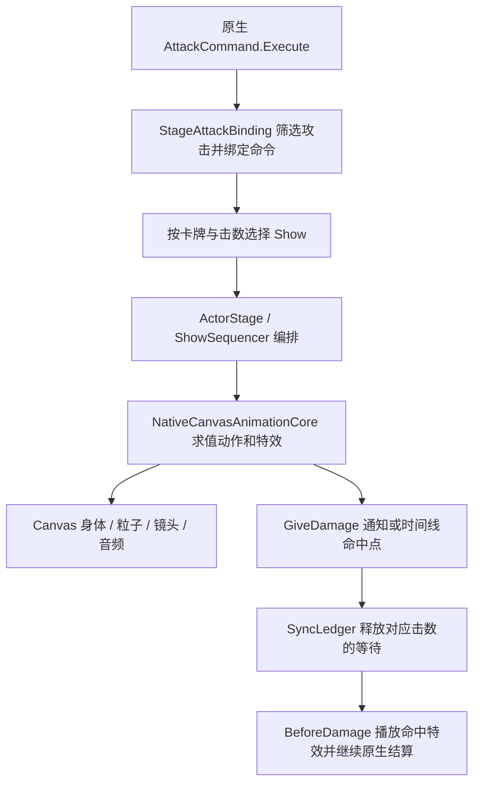

# 瓦伦希娜 Mod 特效制作学习笔记

整理日期：2026-10-29。研究对象：[《Slay the Spire 2》创意工坊「拇指护父——瓦伦希娜」](https://steamcommunity.com/sharedfiles/filedetails/?id=3747747045)，工坊 ID `3747747045`。本文依据本次实际下载的 **Valencina 0.10.0** 发布包、恢复资源及 DLL 反编译结果整理。

**最值得学习的是把一次出招组织成统一演出：动作与材质决定画面，时间线决定节拍，真实攻击命令决定伤害次数，再由专门的适配层将两者对齐。** 局部效果则保持简单：原生拖尾换材质、卡缘复用原生高亮、速度线只绘制需要的几何。

本次完成下载、PCK 条目校验、资源恢复和静态调用链分析。游戏内播放、首次使用帧耗时、双版本及多人验证均未执行；下文的秒数是资源配置值或代码计算值。

## 1. 取得的包与研究入口

### 发布包快照

| 项目 | 本次取得的值 |
| --- | --- |
| Mod ID / 清单名 | `Valencina` |
| 清单作者 | `拟南鼠Arabidopsis`；工坊页面显示为「犹格泡泡的狗」 |
| 版本 | `0.10.0` |
| 最低游戏版本声明 | `v0.107.1` |
| 依赖声明 | `STS2-RitsuLib >= 0.5.11` |
| DLL | `Valencina.dll`，3,247,616 字节 |
| PCK | `Valencina.pck`，182,795,128 字节 |
| 其他随包文件 | 清单，以及 3 个外置 MP3 |
| PCK 格式 | v3，Godot `4.5.1`，2,841 个条目，逐条 MD5 校验通过 |

使用项目已有的 [Steam 下载脚本](../tools/reference/download_workshop_samples.py)，通过运行中的 Steam 客户端调用 `ISteamUGC.DownloadItem`。下载后复制到研究目录；脚本未调用订阅接口，研究包放在 `artifacts/` 下。

研究根目录：[`artifacts/reference-mods/valencia-vfx-2026-10-29/`](../artifacts/reference-mods/valencia-vfx-2026-10-29/)。

| 子目录 / 文件 | 用途 |
| --- | --- |
| `packages/3747747045/` | Steam 实际取得的六个文件 |
| `unpacked/3747747045/` | 保留发布形态的原始 PCK 条目 |
| `recovered/3747747045/` | GDRE 恢复的场景、Shader、纹理、脚本等 |
| `decompiled/3747747045/` | ILSpy 独立反编译 DLL，本文判断运行行为的主要依据 |
| `download-provenance.json` | 下载状态、文件尺寸与 SHA-256 |
| `pck-inventory.json` | PCK 版本、路径、逐文件 MD5 与校验结果 |
| `analysis-inventory.json` | 恢复资源的扩展名、场景节点与图片尺寸统计 |
| `effective-shows.json` | 按代码加载顺序合并后的 27 份演出定义 |

上述研究文件由 `.gitignore` 的 `/artifacts/` 规则排除，本地保留以便继续查阅。本文中的证据链接依赖这份本地研究目录。

### 资源规模怎样读

恢复结果包含 876 张 PNG、50 个 `.tscn`、13 个 `.tres`、127 个 `.gdshader`、144 个 `.gd`、225 个 `.res`、89 个 WAV 和 48 个 MP3。统计覆盖整个 Mod，包括卡图、怪物、UI、剧情与运行库。其中 393 张 PNG 位于怪物图片目录，194 张位于卡图目录。

127 个外置 Shader 中，72 个位于主角色 `native/1379/native_fx/`，38 个位于协助角色 `native/1306/native_fx/`。这反映了大量逐材质的移植资源；学习时更适合先找共同结构，再读个别材质。

文本场景本地声明仅有 1 个 `GPUParticles2D`、2 个 `CPUParticles2D`，而主体演出通过运行时 Canvas 网格输出粒子。**查看场景时，应继续追到运行时创建的节点和绘制代码。**

GDRE v2.7.4 记录 950 项成功转换、15 项有损恢复、0 项转换失败；另列出 131 个未单独恢复的脚本路径，包含大量 C# partial 源路径。ILSpy 从程序集按合并后的类型恢复代码。包内未包含 `.aep`、`.blend`、`.psd`、`.spine` 等制作工程；本文讨论发布实现与可复用制作方法。

## 2. 先把效果分成六类

| 效果 | 实际实现 | 最值得学习的部分 |
| --- | --- | --- |
| 主角色招式、处置、协助攻击 | 演出 JSON + 自定义动作/粒子运行时 + Canvas 输出 | 动作、特效、镜头、声音、命中共用节拍 |
| 冲刺残影 | 当前身体绘制快照 + Canvas RID 回放 | 只保存可重放的身体几何，复用绘制对象 |
| 移牌拖尾 | 原生 `NCardTrailVfx` / `NCardTrail` + 两条 `Line2D` + 粒子 | 运动沿用原生，主要重做材质与层次 |
| 处置牌卡缘 | 原生卡框 SDF + 双层噪声溶解 Shader | 形状贴合卡框，强度跟随原生高亮宽度 |
| 加速未来速度线 | `_Draw()` 径向线段 + 局部遮罩 Shader | 用少量几何表达速度，避开角色与关键信息 |
| 能力附着表现 | Power 状态刷新 + Stage buff；另保留图集式狩猎标记代码 | 常驻效果由真实状态维持，核对启用入口 |

主体运行库的 `native` 是包内命名。其可见结果在 Godot Canvas 上绘制；源码中的 `Node3D` 也承担变换与源场景数据职责。

## 3. 主体招式：让多个表现轨道一起工作

### 3.1 从出牌到真实命中的链路



[攻击入口][attack-patch] 给 `AttackCommand.Execute` 加补丁；[绑定层][attack-binding] 确认攻击来源、角色、设置和播放条件，再建立 command ID 与演出请求的对应关系。它保存已有的 `BeforeDamage` 回调，追加等待和命中表现，之后继续原回调。

每击等待由 `SyncLedger` 管理，使用 `TaskCompletionSource`；命中点到达才释放对应击。`CommandBinding.WaitForNextHit()` 有默认 10 秒超时，超时释放整个命令的等待并写日志。退出与异常同样需要释放等待，保证卡牌流程继续。

[动画配置映射][profiles] 的例子：

- `JieLuAttack` 使用 `S4`；`JieXiangAttack` 使用 `S6`。
- 实现 `IDisposalAttackCard` 的临时处置攻击使用 `S7`。
- 追击反击使用 `S3`。
- 普通单击使用 `1379/NormalSingle`；多击或群攻使用 `1379/NormalMulti`，并有入段与续段变体。

这里的《意志》对应 `Disposal.cs`，是一张施加能力的技能牌；长处置攻击对应 `IDisposalAttackCard` 分支。检索时用接口与调用链区分它们。

### 3.2 演出定义与覆盖顺序

[初始化][bootstrap] 从 `animations/native/library.json` 校验 `native_canvas_external_time_v1` 后注册后端。[ShowLibrary][show-library] 的加载顺序是：

1. `Valencina/stage/shows/*.json` 提供基础定义。
2. `library.json` 中的 `units[].stage_shows` 替换同 ID 定义。
3. `Valencina/stage/show_overrides/*.json` 递归覆盖对象属性；数组等值整体替换。

因此，研究时间线要按最终合并值读取。本次按相同顺序整理了 [27 份有效定义][effective-shows]。

一个具体差异：磁盘上的 `stage/shows/1379_S3.json` 写约 **2.7667 秒**；`library.json` 的编译来源定义将它替换为约 **1.4833 秒**，两个命中点为 **0.60 / 0.95 秒**。

| 有效定义 | 片段数 | 片段时长之和 | 配置命中点数量 | 镜头用途 |
| --- | ---: | ---: | ---: | --- |
| `1379/NormalSingle` | 2 | 1.7000 秒 | 2 | 普通攻击 |
| `1379/NormalMulti` | 1 | 0.7833 秒 | 2 | 多击主体；首次可走独立入段 |
| `1379/S3` | 2 | 1.4833 秒 | 2 | 追击 |
| `1379/S4` | 3 | 3.3667 秒 | 10 | 长招式 |
| `1379/S6` | 4 | 4.7833 秒 | 12 | 长招式 |
| `1379/S7` | 5 | 8.6000 秒 | 16 | 处置，启用 `rawCalibrated` 镜头与 FocusFrame |

以上时长来自 `sum(sourceOut - sourceIn)`；前后摇衔接、声音尾部、设置及运行时源序列会影响实际播放过程。

### 3.3 以 S7 处置拆解时间线

[S7 定义][s7] 包含五个时间线片段，长度依次约为 **2.5833、1.3000、1.2000、1.4833、2.0333 秒**。16 个命中标记分布在多段连击中，最后一个在约 **7.5167 秒**，标为 `finisher`。约 **8.6 秒**是配置尾部边界。

`phases` 单独声明起手结束、有效阶段结束和取消窗口；`afterimages` 声明残影的时间区间；`camera`、`usesFocusFrame` 声明镜头与聚焦表现。这样的数据组织很适合长招式：调整一段停顿、尾部或镜头策略时，有明确的修改位置。

`NativeCanvasAnimationCore.Actor.CurrentUsesSourceSequence` 对 Cinematic 和 Assist 采用源序列。`ShowSequencer.SourceImpact(cueId)` 用实际 `GiveDamage` 通知匹配命中标记，并对同一 cue 去重；其他路径也支持按时间推进命中。制作时应让可见接触、声音重音与命中 cue 使用同一份节拍信息。

### 3.4 视觉攻击次数与规则击数怎样配合

[HitSchedule][hit-schedule] 的职责是把动画命中点分配给真实攻击次数：

- 规则击数较少时，优先保留末击，再按优先级和时间间隔选择承载点；其余点保留视觉反馈。
- 规则击数超过现有点数时，先使用现有点，剩余击数分配到末击。
- 支持循环且属于相应非 Cinematic 演出时，可展开循环区间。
- 真实击数改变后，重新安排尚未触发的部分。

例如 `JieLuAttack` 的攻击命令基础为 3 击，S4 有 10 个视觉命中点。表现可保留完整动作节奏，伤害由原生命令的实际击数控制。这对华恋的额外重播、多段攻击很有参考价值：先定义每段表达的规则意义，再决定哪些帧承载结算。

## 4. 主体画面怎样从资源变成可见特效

### 4.1 身体、粒子和后处理分开

`animations/native/1379/character.res` 和 `1306/character.res` 保存自定义角色资源；配合 `NativeCharacterDefinition`、Spine 数据、粒子定义与逐材质 Shader，由共享运行库求值。

[Canvas 适配器][canvas-core] 安装运行时后，将输出放到 `NativeAnimationCanvas`，绑定前景绘制容器，并按实际角色参考节点校准坐标。接管时保存 `IdleSpine`、受击等旧节点的可见性与处理模式，交还时恢复。

[NativeParticleCanvas2D][particle-canvas] 继承 `MeshInstance2D`，接收已提交的 `ArrayMesh`，绑定额外粒子数据纹理，将 `shader_time` 和 `host_modulation` 写入材质。某个材质的 Shader 可以从额外数据纹理读取顶点关联信息，组合主纹理、噪声、UV、颜色及自定义数据。

这条路线保留了源动作和粒子材质的许多细节，工程量也覆盖了资源转换、时间推进、身体求值、粒子状态、材质适配和 Canvas 绘制。华恋新增少量原创刀光、星轨或光束时，可以先使用现有节点、Shader 与 `Line2D` 完成同样的分层思想。

### 4.2 坐标校准值得单独做

[NativeActorCoordinates][coordinates] 将源 Spine 像素坐标框架映射到实际角色节点；点与位移分开换算，处理 Y 轴方向、宿主变换和 root motion。这样角色、敌方目标、光效和镜头能共享坐标依据。

可迁移的制作习惯：先明确角色局部、战斗 Canvas、屏幕 UI 各自的坐标域；在挂载边界转换位置，给方向和距离提供实际目标。华恋的角色斩击、约定之塔与手牌交接分属不同父容器，应沿用各自已有的坐标转换入口。

### 4.3 发光还涉及颜色空间和混合方式

包内材质存在 `blend_premul_alpha`，部分通用合成 Shader 显式处理线性 / Gamma 颜色，并组合独立 bloom 图像。`native_canvas_fx_bloom.gdshader` 会检查异常 bloom 值，再按当前 Canvas 颜色域合成。

制作时要同时检查纹理透明度、预乘方式、加法强度和背景。刀光主体需要可辨认的形状，外层泛光再增加亮度；单独提高 RGB 容易让细节和叠加层次一起消失。

## 5. 三个适合华恋直接借鉴的局部方案

### 5.1 移牌拖尾：宽烟带、细亮线、散点分工

[拖尾场景][trail-scene] 的主脚本直接引用游戏的 `NCardTrailVfx` 和 `NCardTrail`，并通过角色 `CharacterVfxAssetSet` 接入。其构成如下：

| 层 | 关键参数 | 作用 |
| --- | --- | --- |
| `OuterTrail` | `Line2D`，宽 140，深红主体与暗边，`additive=0` | 形成厚度和主要运动轮廓 |
| `InnerTrail` | `Line2D`，宽 40，橙红亮芯，`additive=1` | 强调方向和高速亮线 |
| `BigSparks` | 28 个 CPU 粒子，寿命 1.2 秒，低速，零重力 | 缓慢散开的余烬 |
| `LittleSparks` | 64 个 CPU 粒子，寿命 0.3 秒，向下重力 | 短促火花 |
| 两个卡牌剪影 Sprite | 不同颜色、尺寸和透明度 | 连接真实卡面与拖尾亮部 |

这些是场景声明值；游戏运行时的实际活动量受发射和生命周期影响。

[拖尾 Shader][trail-shader] 组合三张纹理：主形状、噪声、溶解。噪声偏移 UV，沿 `UV.x` 从尾到头插值溶解偏置，再通过硬度和双颜色形成内芯与边缘。

其思路可概括为：

```text
主形状 = sample(mainTexture, 加噪后的 UV)
溶解值 = sample(dissolveTexture, 滚动 UV)
阈值偏置 = lerp(尾部偏置, 头部偏置, UV.x)
可见度 = smoothDissolve(主形状 × 溶解值 + 阈值偏置) × 主形状
颜色 = lerp(暗边, 亮芯, 主形状) × 强度
```

`anim_time` 参数允许外部传入时间；缺省值 `< 0` 时使用 `TIME`。独立特效若要精确暂停、重播或录制，可显式传入该次演出的时间。

**华恋应用建议**：入塔 / 出塔保留真实移牌节点、完成通知和现有轨迹，宽层画柔和金色形状，细层画白金亮芯；粒子只补短尾部。先调两条带的比例、头尾宽度曲线与溶解，再调整粒子数量。

### 5.2 卡缘光效：复用原生轮廓与节拍

[卡缘补丁][halo-patch] 在 `NHandCardHolder.UpdateCard` 后检查 `IDisposalAttackCard`，给原生高亮添加同级 `TextureRect`，绑定原高亮。场景材质设置 `resource_local_to_scene=true`，鼠标过滤为 Ignore。

[GDScript][halo-script] 复制高亮的纹理、锚点、偏移和拉伸方式，并读取原材质的 `width`：

```text
strength = 原生高亮 width / 0.075
visible = width > 0.0005
```

因此显示、闪烁和隐藏沿用原生高亮的节拍。[卡缘 Shader][halo-shader] 结合原生卡框 SDF、两层不同速度的向上噪声、硬溶解和双色渐变；边缘另保留连续细线，让流动火舌仍有稳定的轮廓。

这个实现会将原生高亮透明度设为 0；卡牌更新成其他模型时删除装饰并将高亮恢复为白色。华恋当前的闪耀与燃烧卡缘已有模型身份和回池清理约定，借鉴时应把轮廓、节拍与独立材质接入这些现有管理点，并保存需要归还的原状态。

**华恋应用建议**：临界闪耀保持一圈稳定细边，外侧用低幅度噪声做流动；强度绑定实际闪耀状态或原生高亮包络。卡牌模型变更、回池、离开手牌时统一拆除对应装饰。

### 5.3 加速未来：少量速度线与保护区域

[屏幕表现节点][future-effect] 读取本地玩家 `AcceleratedFuturePower`，视觉层数限制在 0–10。增加层数有 0.20 秒短增强，过热有 0.16 秒短反馈。

[几何绘制][future-geometry] 用 `DrawLine` 在屏幕外缘附近画径向短线：基础线数 `24 + 4 × 层数`，1 层为 28 条，10 层为 64 条；增强期额外叠线。线宽按视口高度缩放，长度、透明度和运动随状态变化。

其 [Shader][future-shader] 只裁剪该节点绘制的几何，最多接收 64 个保护矩形。C# 把角色 Bounds、可识别身体、意图和血条变换到屏幕空间，外扩 10 像素后归一化；Shader 将这些区域内的装饰透明度设为 0。

**华恋应用建议**：觉醒、连击或高速突刺的外围动势可采用短线、星屑或放射光带；先划出手牌、按钮、血条与意图的可读区域，再安排外围装饰。使用 `GetGlobalTransformWithCanvas()` 处理 Canvas 变换，有助于跟随镜头和窗口尺寸变化。

## 6. 残影、镜头和生命周期

### 残影保存身体绘制快照

[AfterimageLayer][afterimages] 调用 `CaptureBodySnapshot()`，取得可重放的身体快照，使用 `RenderingServer.CanvasItemCreate()` 建立绘制项并回放。透明度按 OutCubic 衰减，结束时释放快照，把绘制 RID 放回池；退树时清理活跃项并释放池内 RID。

自动残影以身体屏幕移动速度为门槛，默认 **900 像素/秒**；采样门控间隔为 **1/60 秒**，每次 Update 最多采一次，默认寿命 **0.35 秒**，冲刺默认 **0.40 秒**。这些参数描述当前代码策略，实际开销仍需游戏内采样。

可借鉴的顺序是：限定残影出现区间 → 判断当前动作速度 → 只复制身体可见内容 → 限制采样 → 池化绘制对象 → 集中释放。华恋要做短冲刺残影时，先限定时段和数量预算，再考虑完整身体快照后端。

### 镜头与 UI 有明确持有者

`CameraBrain` 保存基础变换，持有当前镜头 owner 与震动源，并在释放时归还状态。`UiConcealer` 用 lease 集合管理淡出请求，最后一个 lease 释放后再逐步恢复保存的原颜色。

[CombatStage.AbortAll][combat-stage] 集中处理协助角色、演员、规则等待、延迟死亡、聚焦框、UI、背景和音频。房间退出、战斗结束和演员异常也有对应入口。

**华恋应用建议**：一个演出拥有自己的前景、背景、镜头、声音和完成任务；清理时同时归还这些资源。涉及多人或重播的共享舞台效果，沿用当前 `KarenStarlightStage` 与 `KarenVfxComposition` 的持有和合成约定。

### 准备资源与真实绘制分开记录

启动资源补丁在 `LoadDeferredStartupAssetsAsync` 后发起 `StartPrewarm`。其 `WarmActor` 会等待启动任务、加载定义与脚本、准备实例输入，在根节点建立隐藏且停止处理的 `NativePreparedActor`，预先安装运行时，供后续接管。

这里可借鉴的是把资源解析、静态数据准备和实例安装前移。本次研究确认了这条准备路径，GPU 首次绘制与首次使用耗时列为未测。华恋已有 [`KarenVfxWarmup`](../src/Core/Vfx/KarenVfxWarmup.cs)，继续按项目约定记录资源准备、真实绘制与渲染完成三个阶段。

## 7. 阅读这个包时需要核对的旧入口

| 看见的文件 / 字段 | 当前包中的状态 | 阅读方法 |
| --- | --- | --- |
| `S3DisposalSequencePlayer` | 只剩 391 帧、60 fps、6.516667 秒三个常量；本次 DLL 检索未找到业务引用 | 主处置沿 `StageAttackBinding → S7` 阅读 |
| `ValencinaAttackBurgundyOverlay` | 场景仍实例化；`_Ready()` 隐藏，只在 `PlayFor("disposal")` 启动；本次静态检索未定位业务调用者 | 作为保留的叠层实现研究，游戏内启用情况列为未测 |
| `HuntingTargetVfxController.VisualEnabled` | 静态只读 bool 在本次反编译结果中保持默认 false | 狩猎标记的图集、锚点和脚本可研究，当前分支进入删除 / 退出路径 |
| `CombatPresentation.IsEnabled` | 返回 false，多个 `QueueNext…` 兼容方法为空 | 新 Stage 补丁直接绑定原生攻击，继续追 Adapter 与后端注册 |
| `stage/shows/1379_S3.json` | 基础值被 `library.json` 同 ID 定义替换 | 以合并后的 1.4833 秒配置为准 |

这些保留代码本身也能提供局部做法，例如叠层的淡入淡出包络；判断实际效果时，先确认入口、条件、调用者和退出路径。

## 8. 转化为华恋的制作步骤

本节是根据研究提出的应用建议，本次只新增文档。

1. **先写效果时间线。** 每张卡只列起势、接触、规则反馈、收尾；每击标出真实结算事件。多段攻击同时列视觉命中点和实际击数。
2. **选最小合适载体。** 刀光 / 星轨优先局部网格或 `Line2D`，常驻轮廓用 Shader，少数固定重型演出再使用透明序列帧。素材负责形状，代码负责实际坐标和时序。
3. **拆出主形、亮芯、散点。** 分别调整面积、透明度和寿命。为纹理确定预乘 / 加法混合方式，在明暗背景和已有舞台效果下核对层次。
4. **接真实事件。** 攻击在实际命中入口确认；移牌观察真实卡牌节点；Power 按实际身份和层数维护。等待任务有完成、取消、退树和异常释放路径。
5. **接现有质量与准备流程。** 使用 [`KarenVfxQuality`](../src/Core/Vfx/KarenVfxQuality.cs) 的完整 / 低 / 关闭预算；共享纹理与 Shader 加入首次使用登记。修改资源时按需运行静态清单检查。
6. **按本次改动定向验证。** 检查目标、重播、关闭档、退场和清理；涉及移牌时保存并查看前后截图，动画结束后执行 `karen_check_hand`。完整矩阵与特效帧耗时专项按用户要求开展。

后续落地前参照 [main 特效总览与兼容约定](21.特效总览与兼容约定.md)、[卡牌特效制作经验](15.卡牌特效制作经验.md) 和 [首次使用工具说明](../tools/vfx/first-use/README.md)。优先尝试“原生拖尾换材质”与“已有卡缘绑定状态”这两类改动，范围清楚，也最容易沿用当前系统。

## 9. 来源、复查与验证范围

### 推荐阅读顺序

1. [角色攻击映射][profiles]、[攻击绑定层][attack-binding]：先看触发对象与真实结算。
2. [资源库][native-library]、[S7 定义][s7]、[有效定义快照][effective-shows]：理解时间线与覆盖关系。
3. [Canvas 后端][canvas-core]、[粒子输出][particle-canvas]、[坐标校准][coordinates]：理解主体画面如何落到游戏中。
4. [拖尾场景][trail-scene] 与 [Shader][trail-shader]：最适合先动手做原创变体。
5. [卡缘脚本][halo-script]、[Shader][halo-shader]、[补丁][halo-patch]：理解原生节拍和局部替换。
6. [速度线几何][future-geometry] 与 [遮罩][future-shader]：理解低素材成本的外围表现。
7. [残影][afterimages]、[战斗清理][combat-stage]：最后检查持有、回收与中断。

### 快照哈希

| 文件 | SHA-256 |
| --- | --- |
| `Valencina.dll` | `f1798e47eac917beb157a2e6489509d48da3d8ec1bfd135e55feec060f99e21d` |
| `Valencina.pck` | `d7d0cd20c136748a705e2c706c7b8a9eaa1ce585609b57e32c8ed5921fbdf1b4` |

### 本次验证记录

| 项目 | 结果 |
| --- | --- |
| Steam 实际下载并保存原始包 | 通过，六个文件 |
| 原始文件 SHA-256 | 已记录 |
| 2,841 个 PCK 条目的 MD5 | 通过 |
| 场景、纹理与 Shader 恢复 | 完成；GDRE 的 15 项有损恢复及 131 个未单独恢复脚本路径保留在日志中 |
| 独立 DLL 反编译与关键调用链阅读 | 完成 |
| 演出定义覆盖顺序与本文数值核对 | 完成，保存 27 份有效定义 |
| 瓦伦希娜游戏内播放、画面与音轨核对 | 未测，本次范围为发布包静态研究 |
| 正式版 / 测试版、单人 / 多人兼容性 | 未测 |
| GPU 首次绘制、重复帧耗时与长帧 | 未测 |

下载依据：[瓦伦希娜工坊页面](https://steamcommunity.com/sharedfiles/filedetails/?id=3747747045)。工具参考：[Steam `ISteamUGC.DownloadItem`](https://partner.steamgames.com/doc/api/ISteamUGC#DownloadItem)、[GDRE 官方项目](https://github.com/GDRETools/gdsdecomp)。具体实现结论以上述本地发布包证据为依据。

[attack-patch]: ../artifacts/reference-mods/valencia-vfx-2026-10-29/decompiled/3747747045/Valencina.ValencinaCode.Presentation.Stage.Adapter/AttackCommandStagePatch.cs
[attack-binding]: ../artifacts/reference-mods/valencia-vfx-2026-10-29/decompiled/3747747045/Valencina.ValencinaCode.Presentation.Stage.Adapter/StageAttackBinding.cs
[profiles]: ../artifacts/reference-mods/valencia-vfx-2026-10-29/decompiled/3747747045/Valencina.ValencinaCode.Presentation.Stage.Adapter/AttackPresentationProfiles.cs
[bootstrap]: ../artifacts/reference-mods/valencia-vfx-2026-10-29/decompiled/3747747045/Valencina.ValencinaCode.Presentation.Stage.Runtime/StageBootstrap.cs
[show-library]: ../artifacts/reference-mods/valencia-vfx-2026-10-29/decompiled/3747747045/Valencina.ValencinaCode.Presentation.Stage.Core/ShowLibrary.cs
[native-library]: ../artifacts/reference-mods/valencia-vfx-2026-10-29/recovered/3747747045/Valencina/animations/native/library.json
[effective-shows]: ../artifacts/reference-mods/valencia-vfx-2026-10-29/effective-shows.json
[s7]: ../artifacts/reference-mods/valencia-vfx-2026-10-29/recovered/3747747045/Valencina/stage/shows/1379_S7.json
[hit-schedule]: ../artifacts/reference-mods/valencia-vfx-2026-10-29/decompiled/3747747045/Valencina.ValencinaCode.Presentation.Stage.Core/HitSchedule.cs
[canvas-core]: ../artifacts/reference-mods/valencia-vfx-2026-10-29/decompiled/3747747045/Valencina.ValencinaCode.Presentation.Stage.Runtime/NativeCanvasAnimationCore.cs
[particle-canvas]: ../artifacts/reference-mods/valencia-vfx-2026-10-29/decompiled/3747747045/NativeParticleCanvas2D.cs
[coordinates]: ../artifacts/reference-mods/valencia-vfx-2026-10-29/decompiled/3747747045/Valencina.ValencinaCode.Presentation.Stage.Runtime/NativeActorCoordinates.cs
[trail-scene]: ../artifacts/reference-mods/valencia-vfx-2026-10-29/recovered/3747747045/Valencina/scenes/vfx/valencina_card_trail.tscn
[trail-shader]: ../artifacts/reference-mods/valencia-vfx-2026-10-29/recovered/3747747045/Valencina/materials/vfx/valencina_trail_compact.gdshader
[halo-patch]: ../artifacts/reference-mods/valencia-vfx-2026-10-29/decompiled/3747747045/Valencina.ValencinaCode.Patches/ValencinaDisposalHaloPatch.cs
[halo-script]: ../artifacts/reference-mods/valencia-vfx-2026-10-29/recovered/3747747045/Valencina/materials/cards/disposal_halo.gd
[halo-shader]: ../artifacts/reference-mods/valencia-vfx-2026-10-29/recovered/3747747045/Valencina/materials/cards/disposal_halo.gdshader
[future-effect]: ../artifacts/reference-mods/valencia-vfx-2026-10-29/decompiled/3747747045/Valencina.ValencinaCode.UI/AcceleratingFutureScreenEffect.cs
[future-geometry]: ../artifacts/reference-mods/valencia-vfx-2026-10-29/decompiled/3747747045/Valencina.ValencinaCode.UI/AcceleratedFutureOverlayGeometry.cs
[future-shader]: ../artifacts/reference-mods/valencia-vfx-2026-10-29/recovered/3747747045/Valencina/shaders/accelerating_future.gdshader
[afterimages]: ../artifacts/reference-mods/valencia-vfx-2026-10-29/decompiled/3747747045/Valencina.ValencinaCode.Presentation.Stage.Runtime/AfterimageLayer.cs
[combat-stage]: ../artifacts/reference-mods/valencia-vfx-2026-10-29/decompiled/3747747045/Valencina.ValencinaCode.Presentation.Stage.Runtime/CombatStage.cs
