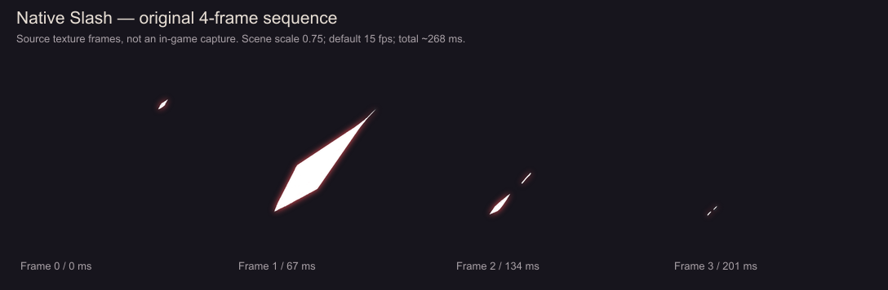
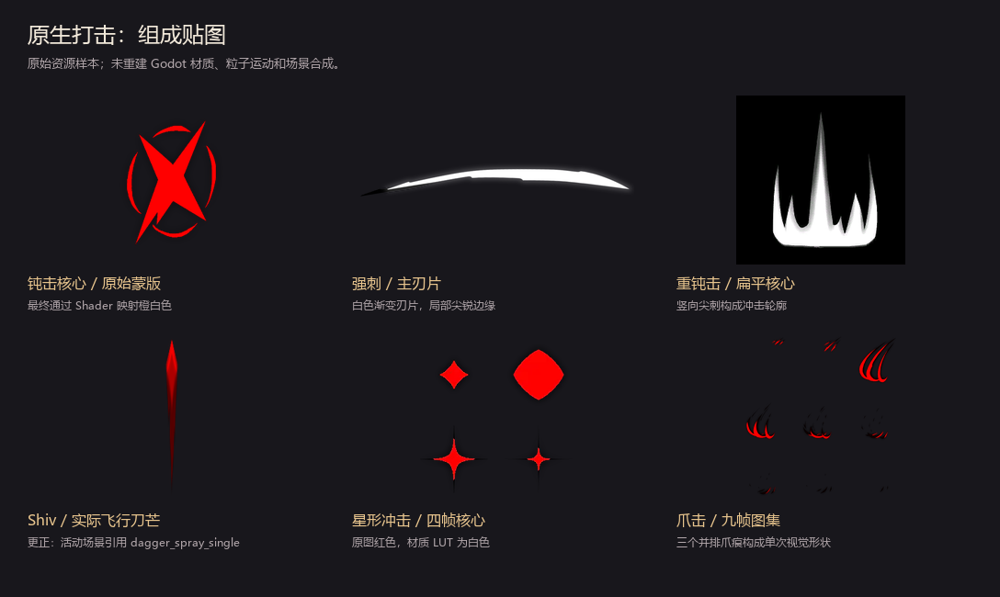

# STS2 原生打击特效分析

2026-10-12。阶段：先建立游戏原生表现基准，暂停《续演》方案设计。此前五种剧情方案未获用户认可，不作为选定方案。

## 分析依据与范围

读取本地游戏提取目录 `D:/Github/spire-codex/extraction/raw/` 的卡牌 C#、VFX 脚本、Godot 场景、材质、Shader 和原始贴图。本轮没有启动游戏；图片是原始资源整理，网页四帧回放也是资源序列回放，不是游戏实录。该提取快照尚未确认对应的游戏版本，不能据此声称已经验证正式版与测试版的运行表现。

时间均相对于相应特效节点启动。粒子 lifetime、可见峰值、节点清理时间、卡牌结算等待是不同概念；表中不会把两秒清理时间描述成两秒持续亮剑。

## 先分清三层

1. **攻击者起势**：角色 Attack 动画，以及卡牌额外的攻击者侧特效。Karen 的 `AttackAnimDelay` 是 0.15 秒；这不是所有攻击特效的寿命。
2. **卡牌命中形状**：刀痕、钝击核心、刺击、星形等，一般生成在目标的 `VfxSpawnPosition`。普通斩击没有从攻击者到目标的连续光束。AOE 的路径型命中特效默认可以在敌方整体中心播放，也可指定逐个目标生成。
3. **伤害通用反馈**：未完全被格挡且实际伤害大于零时，伤害流程添加通用火花、伤害数字、受击动作/音效，并按实际未格挡伤害震屏。卡牌专属 VFX 不必重复搭建这些反馈。

原生伤害火花本身已有亮点、散射碎点、0.35 秒光晕和 0.3 秒向外短划；较弱碎点可以存留约一秒。完全格挡则走格挡火花、格挡提示和音效。

伤害震屏阈值是 `<6` 弱、`6–10` 中、`≥11` 强，取实际未格挡伤害，并受战斗/本地玩家条件控制。某些专属 VFX 自己还会震屏，不能把它们当作没有通用反馈的孤立动画。

源码：

- [AttackCommand 执行顺序](D:/Github/spire-codex/extraction/raw/src/Core/Commands/Builders/AttackCommand.cs:550)
- [VfxCmd 定位](D:/Github/spire-codex/extraction/raw/src/Core/Commands/VfxCmd.cs:209)
- [伤害、火花与震屏](D:/Github/spire-codex/extraction/raw/src/Core/Commands/CreatureCmd.cs:294)
- [通用火花场景](D:/Github/spire-codex/extraction/raw/scenes/vfx/hit_spark_vfx.tscn)
- [Karen 动画等待](../../../src/Core/Models/Characters/Karen.cs)

## 基础类型对照

| 类型 | 形状与运动 | 源码中的节奏 | 使用例子 / 表现作用 |
| --- | --- | --- | --- |
| 普通斩击 | 白色实心尖刃、红边；小亮点突然撑开成大刀痕，然后断成碎片 | 4 帧，默认 15 FPS；约 0 / 67 / 134 / 201 ms，268 ms 后清理 | 五位原版角色基础 Strike、Anger、TwinStrike 等。锋利、清楚、容易连续播放 |
| 快速细切 | 单枚细长粒子从目标周围 400–500 距离处高速穿向命中区，长度迅速缩短，配局部小亮点 | 主划 lifetime 0.18 秒、速度 8000；小亮点 lifetime 0.5 / speed_scale 2；节点 1 秒后清理 | Slice 额外叠此层，再使用普通斩击。轻快感来自短促位移和收缩，细长形状也可以是打击 |
| 普通钝击 | 不规则十字/星状冲击核和破碎圆环，向外散射碎点、带短暗晕 | 核心 lifetime 0.3 秒；节点 1.25 秒；碎点可继续退场 | Bash、PommelStrike、BodySlam、Barrage 等。挤压、碰撞感主要集中在中心 |
| 强刺击 | 尖头、不规则刃缘的长片，局部闪花和火星；朝一个方向穿入 | 主片 lifetime 0.5 / speed_scale 2，名义可见上限约 0.25 秒；火星 0.5 秒；节点 2 秒 | Backstab、PoisonedStab、Assassinate。方向明确，命中核聚在目标附近 |
| 大横斩 | 宽而扁的尖刃横掠，略有随机倾角，沿方向移动后消失 | 单粒子 lifetime 0.5 秒，带寿命随机；节点 2 秒 | Whirlwind、SovereignBlade、GammaBlast 等。靠占用横向面积增加扫击感 |
| 重钝击 | 上方压入的起势，随后扁平冲击核、竖向尖刺、左右地烟、碎屑、扰动 | 起势后等待 0.2 秒，再启动冲击并强震；约 2 秒后清理 | Bludgeon、Uppercut、AllForOne。重量来自蓄势与爆发的反差、地面反馈和震屏 |
| 爪击 | 并排弯曲爪痕，横向镜像变化，配冲击亮点与两侧烟 | 先起势，0.1 秒后冲击；爪痕粒子 lifetime 0.55 秒，9 帧 flipbook；2 秒后清理 | Claw、Maul、RipAndTear 的 NScratchVfx。多个爪痕是形状，不自动代表多段伤害 |
| 飞刀 | 高速渐变尖刃、GPU 拖尾与飞行碎点；飞行层之后接目标侧尖形冲击、定向碎点和小烟 | 启动飞行，0.15 秒后启动冲击；再等 2 秒清理 | Shiv。0 费 Token、4 点伤害、升级 +2、消耗，与《续演》机制最接近 |
| 星形冲击 | 紧凑菱形/四角星核心爆开，配小星、环、烟、散点与扰动 | 主星核心 lifetime 0.25 秒；外围粒子可以更长；节点 2 秒清理 | Regent 的 AstralPulse、CrescentSpear 等。星形也能有攻击性，关键是快速爆开 |
| 拳击簇 | 短闪花、散射火花，加少量拳形粒子上冲 | 闪花 lifetime 0.5 / speed_scale 2；拳形 lifetime 0.6 / speed_scale 2；节点 2 秒 | Thrash。具象拳形承担动作辨识，仍以短冲击为核心 |

**四帧不是四次伤害。** 第二帧骤然扩大，后两帧破碎收尾，形成一次砍中的节拍。普通 Slash 场景缩放 0.75，旋转随机整数 0–24°；网页序列为便于比较固定角度，不能当作含人物、跳字、火花的最终合成效果。

上图为原始贴图，未重建 Godot 材质、粒子运动和场景合成。其中红色蒙版尤其不能直接当作成品颜色。

后续 Shiv 专项核对更正：原图曾展示的 shiv_simple 属于调试资源；活动场景实际引用 dagger_spray_single，已更新上图。详细依赖、六层粒子和华丽化建议见 [Shiv 专项分析](shiv-hit-analysis.md)。

## 同一语法里的材质变化

- **血击**：Hemokinesis 的血液 flipbook 主粒子 lifetime 0.5 秒。同一资源也用于自伤表现，因此它表示血液/肉体的材质，不独占某种攻击方式。
- **咬击**：Feed 的 Spine 场景包含上下牙齿和血溅图块；本轮只核对场景、图集与调用，未解码完整骨骼运动，不给出未经核实的咬合时长。
- **雷击**：五个纹理关键帧约每 66.7 ms 更换，同时位置从上方逐步下移；333 ms 调用 queue_free。它以自上而下的方向性建立雷击感。
- **飞行斩击**：Dash、IronWave 使用 `flying_slash` Spine 动画。本轮未还原骨骼时间轴，不把它与普通四帧斩击混为一谈。
- **大刀斩**：PerfectedStrike 组合 NBigSlashVfx / NBigSlashImpactVfx；冲击脚本先起势，0.1 秒后启用强震和命中粒子。大招重量来自组合层和前后对比。
- **匕首群**：DaggerSpray 把攻击者侧 flurry 与逐目标 impact 分开；卡牌 `.WithHitCount(2)` 定义真实两段伤害，视觉粒子的枚数不定义伤害次数。

## 容易看错的资源细节

1. 普通钝击贴图是 5×4 图集，但 Shader 用随机偏移选一行、生命进度选该行五列：**四种变体，每种五帧**，不是连续二十帧。Shader 读取红通道映射橙白 LUT，同时保留 alpha。
2. 星形核心原始贴图发红，但其 LUT 配置为白色，之后还可能乘节点/粒子颜色。它的成品颜色不能只凭 PNG 判断。
3. ThinSlice 的 `VfxColor.Red` 分支实际赋值 `FF9900`，是橙色。命名不等于最终视觉颜色。
4. Shiv 根节点在目标，方向由攻击者和目标的连线确定，投掷发射器有固定局部偏移。不要据此宣称它在所有站位下都严格模拟了从人物手中发出的飞刀轨迹。
5. 专属命中节点被加入场景后，AttackCommand 可以继续结算伤害，并不等待它整个生命周期。内部 0.1/0.15/0.2 秒延迟也不能直接等同于 HP 变化时刻。
6. `.WithHitFx(path)` 只给路径时没有自动指定剑挥声；音效来自显式参数和伤害流程等层。添加声音前需要核对已有来源。

## 对《续演》的直接意义

当前 [KarenContinue](../../../src/Core/Models/Cards/token/KarenContinue.cs) 就是 0 费 Token、单体 4（6）伤害、消耗，使用普通 Slash。最有价值的参照顺序是 **普通 Slash 的命中形状 → ThinSlice 的短运动 → Shiv 的同机制节奏**；这是分析参照，不是已经选定的新方案。

原生轻攻击的特点是“很快变强，又很快让出画面”：白亮核心、尖锐形状、单次明显峰值、残片/碎点收尾。轻攻击也能有长条或飞行层，但它们需要明显位移、缩短和局部冲击；持续连接人物与敌人的均匀发光线，会削弱砍中一次的感觉。

前几版预览的问题：把登塔、灯牌、桥和章节线直接做成主体，先表达了剧情装置，再补一个命中点；长连接线和持续背光占据视觉中心，普通打击自身的实心刀痕、骤然放大、破碎收尾不足。网页也没有把游戏自带的受伤反馈作为基准。重新设计时应先确立一次攻击的形状与节奏，再把剧情符号压进这一瞬间。

本轮不继续新增剧情方案。网页改为固定 1080 px 桌面分析页，提供普通 Slash 原始四帧的原速/慢速回放与类别对照，不做移动端、浅色或多断点适配。

## 可复查入口

基础斩击：[场景](D:/Github/spire-codex/extraction/raw/scenes/vfx/vfx_attack_slash.tscn)、[序列脚本](D:/Github/spire-codex/extraction/raw/src/Core/Nodes/Vfx/Utilities/NSpriteAnimator.cs)。

普通钝击：[场景](D:/Github/spire-codex/extraction/raw/scenes/vfx/vfx_attack_blunt.tscn)、[核心](D:/Github/spire-codex/extraction/raw/scenes/vfx/common/vfx_common_blunt_impact_core.tscn)、[材质](D:/Github/spire-codex/extraction/raw/materials/vfx/common/vfx_blunt_impact_core_flipbook.tres)、[Shader](D:/Github/spire-codex/extraction/raw/shaders/vfx/common/vfx_row_flipbook_shader.gdshader)。

其余：[ThinSlice](D:/Github/spire-codex/extraction/raw/src/Core/Nodes/Vfx/NThinSliceVfx.cs)、[强刺](D:/Github/spire-codex/extraction/raw/scenes/vfx/vfx_dramatic_stab.tscn)、[横斩](D:/Github/spire-codex/extraction/raw/scenes/vfx/vfx_giant_horizontal_slash.tscn)、[重击](D:/Github/spire-codex/extraction/raw/src/Core/Nodes/Vfx/NHeavyBluntVfx.cs)、[爪击](D:/Github/spire-codex/extraction/raw/src/Core/Nodes/Vfx/NScratchVfx.cs)、[Shiv](D:/Github/spire-codex/extraction/raw/src/Core/Models/Cards/Shiv.cs)、[Shiv VFX](D:/Github/spire-codex/extraction/raw/src/Core/Nodes/Vfx/NShivThrowVfx.cs)、[星形核心](D:/Github/spire-codex/extraction/raw/scenes/vfx/starry_impact/vfx_starry_impact_core.tscn)、[雷击](D:/Github/spire-codex/extraction/raw/scenes/vfx/vfx_attack_lightning.tscn)。

补充扫描只统计模型文件中直接写出的 `.WithHitFx("vfx/…")` 字面量，未统计所有常量、分支、自定义节点与其他系统：普通斩击 89 处、钝击 49 处、重钝击 10 处、星形 10 处、强刺 4 处、大横斩 4 处。它们是本快照的静态调用数量，不是运行频率、独立卡牌总数或完整特效目录。
