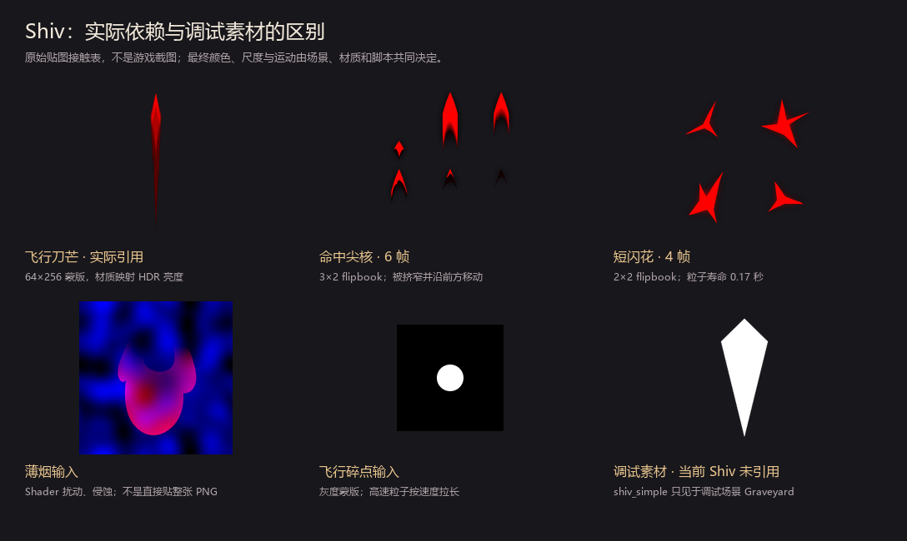

# 以 Shiv 为主体的《续演》特效分析

2026-10-12。用户要求：华丽、多粒子，并进一步指定以 Shiv 特效为主体分析。范围收敛到普通单体 Shiv 的活动场景，不沿用此前四种不同攻击动作的构想。

本篇记录分析阶段的本地提取源码、Godot 场景、材质与 Shader 证据；资源快照版本尚未确认。分析阶段尚未启动游戏；后续已制作“绯光贯刺”并完成两版专项实录，见 [游戏实装记录](game-implementation.md)。下方设计参数保留分析阶段的草案身份，最终参数以实装记录为准。

## 先更正一处资源归属

之前总览图展示的 shiv_simple.png 不是当前活动 Shiv 场景引用的刀形。它与 shiv_trail.png 出现在调试场景 combat_vfx_playground.tscn 的 Graveyard 中。

实际依赖是：

Shiv.cs → NShivThrowVfx → vfx_shiv_throw.tscn → dagger/vfx_dagger_spray_dagger.tscn → dagger_spray_single.png + vfx_dagger_spray_single.tres。

因此主体应该理解成**高速、有尖头的渐变刀芒及几何拖尾**，不能只凭调试目录中名为 shiv 的小刀图标判断。

## 动作：一枚刺入，前方喷出

Shiv 最重要的动作是：先沿攻击者指向目标的方向掠过一枚尖刃，随后在目标处闪出小爆点，并沿刺入方向继续喷出尖形冲击与细长火花，薄烟和弱碎点最后消退。

它的整体轴线明确；不是由许多不同方向的刀组成的乱斩。冲击端的主要方向也没有被改成均匀的全向圆形爆炸。方向、速度、形状比单纯粒子数量更能说明“一刀刺中”。

## 六个发射器如何分工

以下为父场景覆盖子场景后实际生效的参数。不能直接读子场景的 18 枚飞刀，把 Shiv 误写成一次扔 18 刀。

| 层 | 生效数量 / 时长 | 形状与运动 | 作用 |
| --- | --- | --- | --- |
| 飞行刀芒 | **1 枚**；lifetime 0.6 s；速度 9000–12000；scale 1.8–2.2 | 64×256 尖刃蒙版，按速度方向对齐；GPU trail 开启，trail_lifetime 0.2 s | 明确的一枚主刃。0.6 s 是粒子寿命，不是停在目标处发亮的时间 |
| 飞行碎点 | **5 枚**；继承 lifetime 1.5 s，寿命随机 | 100–8000 速度范围；按速度改变长宽，逐步淡出，带扰动 | 提供快慢错层和飞行速度感，不是第二批伤害 |
| 命中尖核 | **1 枚**；lifetime 0.2 s，寿命随机 | 6 帧图集，X 被挤窄，Y 保持较长；局部旋转约 90°；起点目标前方 +80，继续朝前移动 | 主要的穿刺形状，保持尖锐、短促 |
| 命中火花 | **5 枚**；lifetime 0.75 s，寿命随机 | 初速 100–2500，向前为主，混入径向速度、扰动和速度拉伸 | 命中后的喷射与破碎，不是持续光束 |
| 闪花 | **1 枚**；lifetime 0.17 s | 四帧图集，随机旋转，尺寸快速收缩；z_index 3 | 最亮的一次确认，覆盖瞬间但很快退场 |
| 薄烟 | **1 枚**；lifetime 0.55 s | 从前方 +80 出生，向前移动；透明度较低，Shader 扰动并侵蚀 | 让刃和火花有体积，也衔接尾部消失 |

专属节点六个发射器的 amount 合计 **14**。此数不包含 GPU 拖尾几何、伤害流程的通用火花、并发实例和其他效果，也不是画面峰值可见粒子的严格统计。

## 两段时序

- **节点启动**：Restart 飞行刀芒与飞行碎点。
- **约 0.15 秒之后**：Restart 尖核、命中火花、闪花与薄烟，并发出一次弱震屏。
- **再等待 2 秒**：清理整个节点。此时长不等于主特效持续亮两秒。

0.15 秒采用 Cmd.Wait，使用 Godot timer，尊重时间缩放；Instant 模式和战斗结束等条件可以跳过等待。因此这是普通计时条件下的名义时序，不是固定的 Task.Delay。Silent 打 Shiv 时另用角色专属 Shiv 动画等待 0.2 秒；Karen 没有这条条件分支，当前普通攻击等待为 0.15 秒。

**节点内时序与伤害结算时序要分开。** AttackCommand 加入自定义命中节点后可以继续调用 CreatureCmd.Damage；Shiv 调用没有显式等待内部 0.15 秒冲击结束。因此不能把这 0.15 秒直接写成游戏 HP 扣除时刻，网页也不能假称复现了原版精确同步。

## 色彩为什么显得亮

原始刀芒是红通道蒙版。飞刃 LUT 将不同强度映射成灰白，最高配置为 (3,3,3) 的 HDR 值；命中核心 LUT 最高为 (12,8,8)，闪花也有超过 1 的 HDR 配置。亮度的层次来自材质和形状，不来自把整张 PNG 涂成绿光。

飞行 alpha 曲线在生命进度约 5%–7% 之间迅速从零变亮。发射器相对目标使用固定偏移：throw_container 的 X 为 -1133，主刃再偏移 -140；攻击者到目标的向量负责旋转。这个结构与延后显形共同决定飞行观感，不能把它概括成每种站位都严格从人物手中发射的物理轨迹。

Shiv 调用传入 Colors.Green，仅对飞行刀芒、命中尖核、命中火花和闪花复制材质后修改颜色。**飞行碎点和薄烟没有加入这组 tint 列表。** 场景的 self_modulate、顶点颜色、LUT、alpha 曲线与渲染设置共同决定最终显示；单独改一个 tint 不代表每一层都变为同色。

## 华丽化应该增加什么

保留 Shiv 的**一枚主刃、同一方向、飞行后接局部命中**，华丽感集中在已有结构的层次与密度上。下面是原创草案参数，不是原生配置或已验证的 Godot 实装。

| 层 | 原生 | 建议起点 | 目的 |
| --- | --- | --- | --- |
| 主刃 | 1 | **仍然 1**；长度约 1.15 倍、宽度约 1.05 倍 | 主体清楚；一次攻击保持一枚主刃 |
| 飞行细碎光 | 5 | **12–18** | 前端少而快，后端细而弱；让飞行有厚度 |
| 命中尖核 | 1 | **仍然 1**；尺度约 1.2 倍，保持挤窄形状 | 最亮峰值仍由一个尖锐形状承担 |
| 命中细火花 | 5 | **28–40**，多数沿前方，少数侧散 | 形成层叠的定向喷射，先快后慢 |
| 次级碎光 | 无独立此层 | **12–20**，延后约 30–60 ms | 第一批细线之后再出现小亮片，让画面有前后层次 |
| 末端亮点 | 无独立此层 | **6–10**，低亮度、约 0.5–0.8 s 消退 | 保留华丽尾韵，不维持完整刀芒 |
| 闪花 / 薄烟 | 各 1 | **各保留 1**，闪花略放大、烟维持很薄 | 避免多次闪花被读成多次命中 |

这套起点约 **62–92 个专属初始粒子**（1 + 12–18 + 1 + 28–40 + 12–20 + 6–10 + 1 + 1）。主体刀芒、冲击核与闪花仍保持约 0.15–0.25 秒的短峰值；新增粒子通过延后、大小、速度和透明度形成层次。

### 三种配色与粒子外观，动作都沿用 Shiv

1. **绯光贯刺**：暖红边缘、白亮尖核、少量金色细火花；新增碎光为短尖片。最像华恋自身的迅速剑击，建议作为主体方向。
2. **再燃灯屑**：同样一枚贯刺主刃，命中碎光改为红白成对的小亮点，以少量时间错开闪出。只转译再生产灯泡的色彩与闪耀，暂不画完整灯牌。
3. **双光贯刺**：一枚主刃保留白亮尖端，拖尾边缘与命中碎光交替暖红/冷白。两色属于同一枚攻击的粒子，不增加第二枚主刃或第二次伤害。

三种都是原创转译，不宣称是 TV 中已核实的剑路。此前剧情证据仍见 [来源核对](source-research.md)。后续选择“绯光贯刺”制作游戏内第一版，另两种仍为草案。

## 连打与接入边界

每次真正打出《续演》创建独立实例；尾光可以稍暗，但每次主刃与命中峰值保留。五张连续出牌时，尤其检查尾部碎光是否抢过新的一枚主刃。粒子寿命不追加到卡牌规则等待中。

若后续沿用 NShivThrowVfx 的结构，需要单独制作 Karen 粒子材质并逐层确认调色，保持实例材质隔离。当前 KarenContinue 使用的普通 Slash 与新的主体刀芒属于同层，最终接入时应只留一套主体；通用伤害火花、跳字和受击流程继续由原生伤害处理。

本篇的分析阶段没有游戏运行验证。后续正式版和测试版的基础牌、升级牌、连续出牌专项覆盖与录屏见 [实装记录](game-implementation.md)，不代表完整机制或多人兼容性结论。

## 源码入口

- [Shiv 卡牌](D:/Github/spire-codex/extraction/raw/src/Core/Models/Cards/Shiv.cs:57)
- [NShivThrowVfx 时序与调色](D:/Github/spire-codex/extraction/raw/src/Core/Nodes/Vfx/NShivThrowVfx.cs)
- [主场景与父级覆盖](D:/Github/spire-codex/extraction/raw/scenes/vfx/vfx_shiv_throw.tscn)
- [飞行粒子子场景](D:/Github/spire-codex/extraction/raw/scenes/vfx/dagger/vfx_dagger_spray_dagger.tscn)
- [命中核心子场景](D:/Github/spire-codex/extraction/raw/scenes/vfx/dagger/vfx_dagger_impact_core.tscn)
- [飞行材质](D:/Github/spire-codex/extraction/raw/materials/vfx/dagger/vfx_dagger_spray_single.tres)
- [飞行 Shader](D:/Github/spire-codex/extraction/raw/shaders/vfx/dagger/vfx_dagger_spray_single_shader.gdshader)
- [命中核心材质](D:/Github/spire-codex/extraction/raw/materials/vfx/dagger/vfx_dagger_impact_core.tres)
- [Cmd.Wait 的计时与跳过条件](D:/Github/spire-codex/extraction/raw/src/Core/Commands/Cmd.cs:35)
- [调试场景资源归属](D:/Github/spire-codex/extraction/raw/scenes/debug/combat_vfx_playground.tscn)
