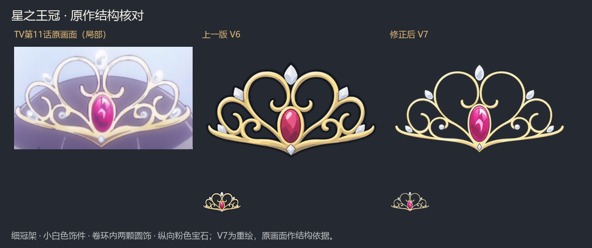

# 七件遗物 V7：去周期纹与王冠造型修正

2026-10-11。按用户反馈修正星之王冠，并使用本地 Mi-Ripple 检查七张原始尺寸母稿。当前游戏资源及图文清单使用 V7；V6 母稿保留为历史对照。

## 星之王冠

结构依据是 TV 第11话的实际动画画面，截图由[此文章转载](https://anime-tip.com/sahplant/revuestarlight/9060)。这是动画画面参考，不称为官方设定集。原始截图保存于 `assets/relic-style-v7/tiara-tv11-reference.jpg`。

V6 将细冠架画得过厚，白色饰件被放大并过度切面化，且漏掉两颗卷环内的小圆饰。V7 恢复浅金细线、较小的白色饰件、两颗内卷环圆饰、下方小菱饰及单颗纵向粉色椭圆宝石；保留两大上卷环、两侧卷环、两颗下卷环与全部镂空。使用内置 ImageGen 重绘及一次定向细化，母稿和两份提示词已保存。它是按动画结构绘制的游戏图标，并非逐像素原图。



## 本地去摩尔纹

使用现有本地 **Mi-Ripple 0.1.0**，源码提交 `865a1481acc22da80427bbebe11f1d7f00dc99be`。调用的是确定性诊断与滤波路线，关闭该工具的重生成。复用了本机已有隔离 Python 环境，没有安装全局依赖，也没有修改其他 Mod 项目的文件。

在1254×1254原始母稿上诊断，检查诊断窗口、热图、滤波对比板及最终大小图。只对检出的孤立周期分量作选择性频域衰减；平坦区没有检出大面积鳞片或颗粒纹，不执行整图磨皮。滤波只改变RGB；将原始alpha逐像素恢复，图像尺寸、物件轮廓、内部镂空和透明边缘完全保留。

| 图片 | 诊断与采用路线 | 验证 |
| --- | --- | --- |
| 华恋的水壶 | 检出周期分量，选择性notch | 通过；全图亮度残差SD 0.1962 |
| 饼干 | 未检出可处理周期纹，保留V6原稿 | 像素不变 |
| 小小星 | 默认notch在轮廓窗口超限；改为25%修正量 | 通过；全图亮度残差SD 0.1175；保留未通过候选与原因 |
| 棒球猫 | 检出周期分量，选择性notch | 通过；全图亮度残差SD 0.1059 |
| Mr. White | 检出轻微周期分量，选择性notch | 通过；全图亮度残差SD 0.0026 |
| 星形发饰 | 未检出可处理周期纹，保留V6原稿 | 像素不变 |
| 星之王冠 | 对修正造型后的新稿诊断，无可处理周期纹 | 保留新稿；八处白色饰件结构已对照 |

保留本体画风需要的明暗分面和非周期手绘笔触。数值仅证明滤波损伤在限制内，不将低分数当作“全部纹理已消失”的证据。JSON侧记、XML轨迹、诊断图和验收图均位于 `assets/relic-style-v7/verification/`，[处理清单](assets/relic-style-v7/moire-review.json)记录输入及采用稿校验值。

## 游戏尺寸与实测

延续V6尺寸规则：顶部栏小图与轮廓85×85，主体最长边79px；独立详情图256×256，主体最长边246px。按alpha>1完整可见轮廓等比打包，母稿alpha保持原样。王冠细线优先遵从原作造型，已在原生顶部栏和详情页确认可读。

| 版本 | 七件纹理加载与尺寸 | 原生画面 | 战斗手牌 | 日志 |
| --- | --- | --- | --- | --- |
| 正式版 v0.107.1 | 通过：small/outline 85×85，big 256×256 | 通过：地图顶部栏、七件详情、三件原版对照、战斗顶部栏 | 模型5/可见5，无异常节点 | 无运行错误 |
| 测试版 v0.111.0 | 同上，通过 | 同上，通过 | 模型5/可见5，无异常节点 | 无运行错误 |

两版分别使用新用户目录与ProfileId 9221/9222，通过KarenSTS2MCP验证，每版保存12张截图，共24张并逐张查看。产物位于 `artifacts/relic-art-native-v7/{stable,beta}/`。测试结束后恢复原设置并关闭本任务两个进程。双版本发行包及测试辅助Mod构建通过；Godot导出退出时仍出现既有的编辑器程序集重载告警，实际发行包已在两版游戏加载并完成上述验证。

本次仅改图稿、资源打包和检查工具，不改变遗物机制；此前44项全面机制测试保留，未重复全面矩阵。原91.6秒合并视频仍是V5历史机制演示，当前外观以V7清单与本次截图为准。

## 复现

```powershell
# 使用已安装Mi-Ripple的隔离Python环境，在原始尺寸诊断与生成候选。
python tools/check_relic_moire.py docs/design/assets/relic-style-v6 artifacts/relic-moire-v7 --names water_bottle cookie little_star baseball_cat mr_white star_hairclip --gentle-on-reject
# 对照记录审阅后，已采用母稿位于V7目录；打包不修改母稿。
python tools/prepare_relic_assets.py
# 构建发行包，然后分别启动工作树内隔离游戏；使用新的ProfileId和输出目录。
pwsh -NoProfile -File tools/build_dual_branch.ps1
pwsh -NoProfile -File tools/relic-regression/launch.ps1 -Branch stable -UserRoot "$PWD/artifacts/relic-art-native-v7/stable" -ProfileId 9221
python tools/relic-regression/check-art.py stable --revision v7
```

测试版使用beta和独立ProfileId 9222。检查脚本从主菜单新开Karen，只用于一次性测试存档。
