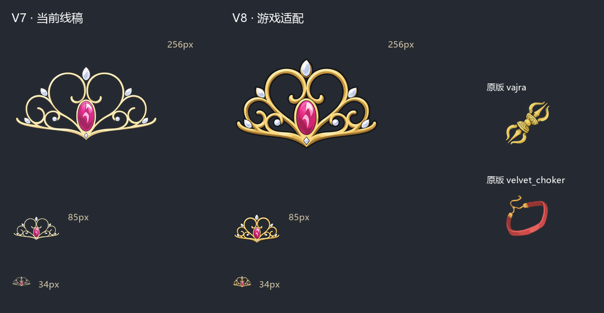
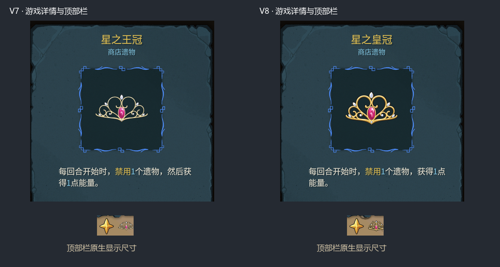

# 星之皇冠：游戏图标适配（V8）

2026-10-12。用户反馈皇冠在游戏内不适合；同时将名称改为“星之皇冠”，描述去掉“然后”。英文名称为Star Crown，日文名称为星の王冠。模型ID和结算机制沿用原实现。

旧稿按原作细冠架绘制，但在顶部栏约34像素的显示尺寸下，线条过细、镂空占比高、横向偏宽，视觉重量明显弱于其他遗物。V8保留六个卷环、八处白色饰件和单颗纵向粉色宝石，收窄两侧、提高主体高度，增强金色线条和深色边界，用暖金、赭色阴影和简单手绘分面呈现物件。

## 图稿与复现

使用**内置image_gen**编辑已有V7稿，原作TV第11话截图提供结构参考，本体遗物提供画风参考。未使用CLI/API替代或手工改变图像轮廓。生成的透明alpha保留；打包只执行既有等比缩放、居中与轮廓生成。

- 当前母稿：[star_tiara.png](assets/relic-style-v8/star_tiara.png)。
- 完整提示词：[star_tiara-prompt.txt](assets/relic-style-v8/star_tiara-prompt.txt)。核心要求是保留原作卷环、粉色宝石与白色饰件，增强缩小时的轮廓和色块辨识度。
- [生成清单](assets/relic-style-v8/generation-manifest.json)记录工具、源文件、日期及参考来源；[素材记录](karen-seven-relics-assets.json)保存母稿SHA-256与实际主体范围。
- 小图和白色轮廓为85×85，详情图为256×256；保留透明镂空，无附加背景。游戏实际显示前分别检查256、85及34像素版本。
- 其余六件的18张游戏PNG与V7逐字节一致；V6、V7稿及原作对照均保留。

运行`python tools/prepare_relic_assets.py`默认使用V8清单，可复现全部当前资源；其余六件引用V7母稿。

## 针对性验证

只核对皇冠外观、名称和描述，未运行全面单人／多人机制矩阵。正式版v0.107.1、测试版v0.111.0分别使用独立的工作树游戏、用户目录、日志和MCP端口15657/15658。测试辅助Mod不进入发行包。

通过KarenSTS2MCP新开Karen，保存地图顶部栏、皇冠详情、三件原版详情对照及战斗顶部栏，每版6张，共12张。详情正确显示“星之皇冠”和“每回合开始时，禁用1个遗物，获得1点能量。”；顶部栏卷环和粉色宝石比V7更清楚。战斗后`karen_check_hand`核对手牌模型与可见节点一致，没有缺失或多余节点。

两版最终日志没有运行错误，设置恢复后关闭本次游戏进程。首次正式版进程在MCP状态读取前结束，保留了连接失败记录，随后单独重启正式版完成上述检查；未推断首次退出原因。

证据位于`artifacts/relic-art-native-v8/{stable,beta}/`。正式版最终档案9243、测试版9242。双版本DLL、加载器和测试辅助Mod编译通过，发行PCK重新导出；导出器仍有既有编辑器程序集重载诊断，以上结果来自实际游戏内验证。

复现：构建双版本包，使用`tools/relic-regression/launch.ps1`启动新隔离档案，再运行`python tools/relic-regression/check-art.py stable|beta --revision v8 --focus-crown`。
