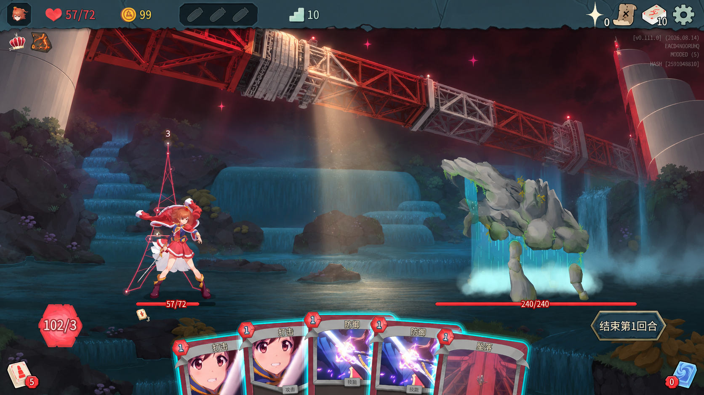

# 约定之塔桥 V2：仰视舞台显影

当前制作为 [V14 横向流光形状修订](../../testing/bridge-v14-rail-glow-2026-10-10.md)。沿桥移动的十字光头与等粗直线拖尾已换成贴合桥体表面的柔和亮斑。其余分层追光、接头火花、浮尘与真实牌框闪光沿用 V13；桥体继续使用 V12 的比例和素材。

2026-10-09。用户观看第一版有声实录后要求重新设计，随后确认本方案并授权制作，要求生成素材去除 AI 摩尔纹。V2 现已接入游戏并完成双版本定向实测，见[制作与实录](../../testing/bridge-v2-vfx-2026-10-09.md)。下文保留设计关键帧与原始编排目标；第一版不再是待合并成品。

本图使用内置 imagegen，以实际战斗截图和现有卡面为参考生成。它重绘了部分人物、环境和 UI，只用于评估构图、造型与光影；不是游戏实录，也不是可直接贴进游戏的完整画面。正式资源必须独立制作透明桥体、边缘塔面和阴影图层，保持游戏原有角色、环境、血条、手牌与 UI。完整[生成提示词](bridge-v2-image-prompt.txt)随文件保存。

## 第一版的问题

- 白塔缺少圆柱的曲面与体积，重复的矩形面读起来像方柱；位置又紧挨两边角色。
- 红白桁架细节、近远大小和明暗过于一致，读起来像工程线框。
- 整体正面横向滑入，画面没有明确的纵深方向；原生卡牌飞到中央后，桥和柱又形成干扰。
- 大布景出现和淡出的时间过近，缺少一个可看清形体的短暂停顿。

## 新构图

核心画面改为从桥下仰望：红白塔身横贯人物上方，近端截出左上边界，远端向右后方收小。桥的底面、侧面、桁架厚度和接头均有明确的明暗关系。深红腹部、偏白骨架和局部暖光形成焦点，不用满屏泛光。

两端白塔仅以边缘弧面暗示尺度，右侧保留卡面中的螺旋分层特征；不在人物身后新增完整柱体。中下部保留战斗空间，角色、敌人和真实自动打出的牌仍是前景。现有约定塔继续显示真实牌堆，不改变造型或位置。

关键帧中图像生成器给出的桥体略向右下延伸，后续以这个可见构图为基准修正图层；不照搬提示词中未被准确执行的向右上描述。保证最靠下的桥体位于角色头顶以上，按各角色实际边界校正，禁止为适配特效移动角色或血条。

## 动作节奏

正常速度约 0.48 秒完成入场，保持时间由本次自动出牌实际结算决定，结束后约 0.45 秒退场。初次实现的固定 1.35 秒生命周期已按用户反馈撤销，见[结算等待修订](../../testing/bridge-resolution-vfx-2026-10-09.md)。

1. **0.00–0.12 秒：舞台落暗。** 只在上方背景叠加羽化的酒红暗部；保留原战斗背景和人物亮度。约定塔尖短亮一次，标识真实牌源；空虚模式改为抽牌堆的短亮。
2. **0.12–0.44 秒：灯光显出桥体。** 一束窄光从近端沿桥向远端走，依次揭出红白结构。桥体只做约 6–12 像素的缓慢视差，产生空间感。主体不再从屏幕左边整条滑进来。素材本身必须能在没有光效时读出体积。
3. **约 0.44 秒起：灯落到出牌位置。** 约 0.48 秒开始实际自动出牌，桥体、暖白光锥和地面光斑持续保留。以一次低沉机械落锁加短促亮音完成接通，控制声音尾巴，不连续撞击。真实卡牌出现时再给出一次小范围照亮。
4. **本次自动出牌全部结算后：布景熄灯。** 收到结束信号后，用约 0.45 秒将边缘塔面、桥体、暗部和主追光共同退场。保持阶段不再按固定秒数提前结束；不会重复播放大型入场演出。

空牌源只保留约 0.2 秒来源点亮后熄灭。X 和升级只影响真实自动出牌数量；不根据 X 生成额外装饰卡片。快速、瞬间模式继续遵循原生节奏。

## 资源和接入约束

- 美术主体改用有明确透视、厚度与受光的独立透明图层；C# 只负责位置、遮罩、灯光和时序，不再用重复矩形和等粗线段凑主形体。
- 桥体、边缘塔面、上方暗部、动态窄追光分别管理。柔和边缘只用于暗部与退场；金属主体不能半透明得像线框。
- 使用游戏后景 VFX 层，不覆盖角色、敌人、血条或手牌；所有图层同属本次出牌，战斗切换时一并清理。
- 保持原约定牌堆先批量移到 Play、再依序自动打出的结算；空虚模式仍走原生抽牌与洗牌。追光跟随实际事件和卡牌节点，不使用按 X 预演的假卡。
- 这套镜头是本次新编排，尚未核实 TV 原片中的具体镜头运动；[先前资料](bridge-source-research-2026-10-09.md)只支持主题与造型参考。

## 后续验证边界

设计阶段只制作了概念图与记录；后续制作和实测结果见文首链接。旧版通过的用例不作为 V2 通过的证据。

接入后仍按用户要求只做双版本定向检查：正常桥体、空牌源、升级与空虚模式，保存移牌前后截图并执行 `karen_check_hand`，录制保留游戏声音的实机效果。保持游戏最小化，明确标注未测项，不运行完整矩阵。第一版的本地提交与工作树保留，未合并 main。
