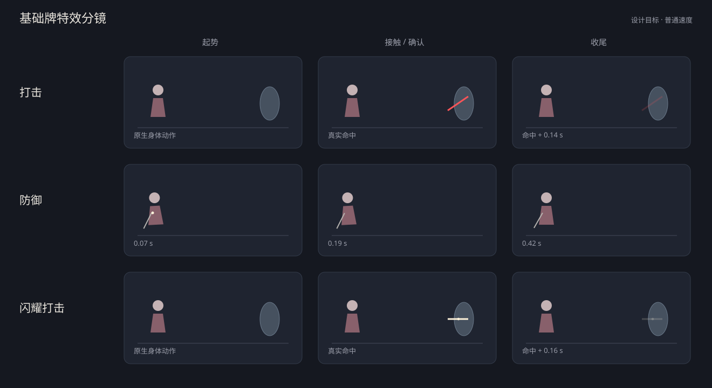

# Karen 卡牌特效分批完成计划

日期：2026-10-29。源码基线：`6a7a9bdc36bb1b33c6eb1b54212d3f0100d5e781`。依据：[逐卡审阅](card-vfx-review-2026-10-29.md)。

用户要求：

- “你来制作一个分批完成计划”
- “要求基础防御或者基础攻击也要有自己的实现，你需要来设计下”
- “开始吧，每一个阶段都要录制前后对比视频”
- “按瓦伦希娜的表现方向重做”
- “我这个朴素点就行，不要加太多东西”
- “可以，继续修改攻击等基础效果”
- “继续下一批”
- “允许重新设计节奏”
- “或者完整特效动画”

**先完成基础牌专属表现，再逐批完善重击、连锁、移牌、选择、收益和舞台。** 全部116个具体卡牌类均分配去向：114张活跃卡进入9个批次，2张停用牌留在候选清单。以下为设计与实施跟踪；2026-10-30从小组1A开始实施，后续按阶段推进。

## 1. 完成口径与共同约定

每张可打出牌都要有明确的表现方案和代码配置入口，体现它自己的动作、轮廓、节拍或结果交接。《打击》《防御》《闪耀打击》使用独立演出节点。普通牌可以通过明确命名的逐卡配置调用共享绘制工具；已有重点牌保留自己的控制器。选项按来源和收益设计图标与短确认，诅咒和占位牌采用适合其机制的静态或消耗反馈。

每个小组按“简要设计与预览 → 实现 → 必要定向验证 → 真实播放交付与修订”完成后再推进下一组。**每个实施小组均录制改前与改后视频**：在同一游戏版本内固定战斗目标、速度、特效档、分辨率和出牌顺序，保存两份包指纹与原片，再生成并排对比。查看真实接触及收尾连续帧后，更新本组验收记录。每次只改当前小组及直接依赖的共享模块。9个批次表示实施顺序；交付边界使用下文的小组，通常为1–6张牌。

### B00：开工准备

1. 为每张牌记录：触发点、起点/终点、主形、确认点、尾部、实现入口、质量档和释放入口。
2. 选取现有角色Bounds、方向、战斗Canvas、图标与真实卡牌节点作锚点；原生Attack轨道继续负责身体动作。
3. 建立少量纯表现工具：刃带/弧面网格、短命中形状、收益脉冲。优先复用 `KarenVfxCanvasBatch`、`KarenVfxQuality`、`KarenVfxComposition` 和 `KarenPowerVfxAnchor`。
4. 记录拟修改资源及加载/绘制准备方式。逐卡配置与材质动态参数保持实例归属，静态纹理、Shader和固定几何共享。
5. 准备第一批的短对照场景与录制入口。源码审阅和本计划保留为基线，后续按实际小组追加记录。

开工准备完成标准：第一批的调用点与锚点可定位、设计分镜可读、原生命令与表现的完成/取消责任明确。

## 2. 第一批：基础牌也有自己的表现

第一批5张：《打击》《防御》《闪耀打击》《坠落》《不再遥不可及》。其中前三张先作为小组1A交付，后两张组成1B。

下列时间是**普通速度下的设计目标**，接触时点须在实现中与原生命令对齐。攻击沿原生攻击时钟安排接触；格挡、取牌等使用真实成功结果确认。Fast按既有速度策略缩短可缩放片段；Instant沿游戏约定提供即时确认。

分镜是轮廓与节拍示意，人物和目标使用锚点图形表示，交付观感以之后的游戏实录为准。

### 2.1 打击：一次短斜切

原生身体攻击照常播放，在真实命中回调创建一条珊瑚红短斜切，约0.14秒退去。只有局部刃形，不额外添加飞刃、接触菱形或散点。完整/低档保持同一主形，关闭/Instant沿原生反馈。

已实现：`NKarenStrikeVfx`，复用共享画布缓冲和实际目标Bounds。节点由当前战斗场景持有，目标死亡后只保留短收尾，换场即释放。

### 2.2 防御：朴素的收身动作

按用户后续选择“按瓦伦希娜的表现方向重做”及“朴素点就行，不要加太多东西”修订。使用华恋现有立绘的一次轻微后压，剑柄处只短亮一下。原生格挡数字与音效保留。

| 时间 | 画面 | 规则联系 |
| --- | --- | --- |
| 获得格挡同帧 | 小幅收身开始 | 在原生正收益分支的VFX时点接入，替换本次防御蓝盾 |
| 0.00–0.07秒 | 重心后压，剑柄处一个小亮点 | 只改变当前角色的局部表现 |
| 0.07–0.19秒 | 短暂停稳 | 原生GainBlock自身的等待继续运行 |
| 0.19–0.42秒 | 轻轻复位 | 后续原生动作可提前接管，无新增规则等待 |

入口仍为 `NKarenDefendVfx`。按本次CardPlay身份与角色限定替换，其他来源格挡保留自己的反馈。姿态由角色当前独立材质承载，动画切换、关闭档、移除节点与退场会复位；重播采用独立持有编号。

完整/低档保持同一轻微动作和最多一个亮点；关闭/Instant沿原生反馈。详细依据、前后视频和验证见[防御重做记录](../testing/defend-vfx-redo-2026-10-30.md)。

### 2.3 闪耀打击：白金直切

真实命中处播放一条白金直切和一个小接触星，约0.16秒退去。节点入口为 `NKarenShineStrikeVfx`，闪耀卡缘、临界与耗尽仍由现有系统负责。完整/低档保持同一主形。

### 2.4 坠落：轻微下沉后真实送塔

格挡正收益时轻微下沉并短亮，约0.26秒复位；实际选择和1/2张卡牌入塔沿用原命令及动画。专属入口 `NKarenFallVfx` 与防御共享底层格挡时点，拥有自己的姿态、短反馈位置和持续时间。

### 2.5 不再遥不可及：轻切后真实归手

一条更轻的短斜切确认3点攻击，约0.10秒退去。专属入口 `NKarenPromiseDrawVfx`；取2/升级取4张、空堆和满手继续按真实牌堆命令运行，以归手卡面作为结果反馈。

### 2.6 第一批预算与接线

| 牌 | 专属入口 | 完整档 | 低档主要保留 |
| --- | --- | --- | --- |
| 打击 | `NKarenStrikeVfx` | 1个短斜切节点 | 同一短斜切 |
| 防御 | `NKarenDefendVfx` | 1次轻微收身、最多1个小亮点 | 同一动作与小亮点 |
| 闪耀打击 | `NKarenShineStrikeVfx` | 1个直切节点、1个小星点 | 同一直切与小星点 |
| 坠落 | `NKarenFallVfx` | 1次短下沉、最多1个小亮点，现有卡面送塔 | 同一短动作、真实卡面 |
| 不再遥不可及 | `NKarenPromiseDrawVfx` | 1个轻切节点，现有卡面归手 | 同一轻切、真实卡面 |

以上是首版预算，随实际观感修订。关闭档沿现有质量配置使用原生攻击/格挡/移牌反馈，规则结算按相同来源运行。完整/低档都保留基础三牌的独立主形。粒子数量进入现有预算函数；固定几何和保留对象另外给出上限。

颜色以现有珊瑚红、白金、暖金为基准。基础牌使用局部画面，身体动作沿原生轨道；材质、固定顶点和可复用工具提前准备。实装后登记新增资源与首次使用准备方式。

## 3. 批次总览

| 批次 | 范围 | 数量 | 前置批次 | 状态 |
| --- | --- | ---: | --- | --- |
| B00 | 入口、锚点、预算与预览准备 | — | — | 1A所需准备完成 |
| B01 | 基础牌专属表现 | 5 | B00 | 完成5/5，待合并 |
| B02 | 重击与常驻伤痕 | 7 | B01 | 原地动作版7/7，待观感复核 |
| B03 | 普通攻击差异化 | 12 | B01、B02 | 待实施 |
| B04 | 自动出牌连锁与规则节拍 | 7 | B02、B03 | 待实施 |
| B05 | 约定牌堆与真实移牌 | 19 | B01、B04 | 待实施 |
| B06 | 选牌与来源选项 | 20 | B05 | 待实施 |
| B07 | 防御成长、食物与即时收益 | 20 | B01、B05、B06 | 待实施 |
| B08 | 能力、舞台与奖励交付 | 18 | B04、B05、B07 | 待实施 |
| B09 | 联机演出、长演出与特殊卡 | 6 | B04、B06、B08 | 待实施 |
| 暂缓 | 披萨、宽恕 | 2 | 恢复进池决定 | 候选 |

下表数量合计为114张活跃卡；加2张候选为116张。每张牌只有一个主负责批次，共享工具可以被后续批次复用。

## 4. 各批次实施小组与逐卡目标

### B01 基础牌专属表现

**目标**：五张入门牌均有明确的专属表现与调用入口；打击、防御、闪耀打击采用独立演出节点。

**完成标准**：五张牌的设计、入口、质量档、释放和实录逐项完成；前三张具有独立轮廓与节拍。

**必要验证**：正式版和测试版各在普通/完整档逐牌核对；升级只覆盖影响形态或次数的分支。Fast/Instant与低/关闭按共享路径选代表定向核对，前三牌低档各看主形。连续打出与异常退场选一条当前小组路径。1B涉及移牌时保存并查看MCP截图，动画后karen_check_hand。

#### 小组1A（3张，朴素版完成）

[阶段初版记录](../testing/basic-card-vfx-stage-1a-2026-10-30.md)；防御以[朴素版重做记录](../testing/defend-vfx-redo-2026-10-30.md)为当前依据。两版完整档逐牌录制，正式版补低档、速度、升级、耗尽、重播与取消路径。

| 卡牌 / 源码 | 本组设计或优化目标 |
| --- | --- |
| [打击](../../src/Core/Models/Cards/basic/KarenStrike.cs) `KarenStrike` | 真实命中时一次珊瑚红短斜切，0.14秒收尾。专属入口：`NKarenStrikeVfx`。 |
| [防御](../../src/Core/Models/Cards/basic/KarenDefend.cs) `KarenDefend` | 一次轻微收身，剑柄处短亮一下，和真实格挡同步。专属入口：`NKarenDefendVfx`。 |
| [闪耀打击](../../src/Core/Models/Cards/basic/KarenShineStrike.cs) `KarenShineStrike` | 白金直切与一个小接触星，0.16秒收尾。专属入口：`NKarenShineStrikeVfx`。 |

#### 小组1B（2张，完成）

[1B实录、移牌证据与第一批合辑](../testing/basic-transfer-simple-2026-10-30.md)。

| 卡牌 / 源码 | 本组设计或优化目标 |
| --- | --- |
| [坠落](../../src/Core/Models/Cards/basic/KarenFall.cs) `KarenFall` | 获得格挡时轻微下沉，真实选牌和送塔沿用现有动画。专属入口：`NKarenFallVfx`。 |
| [不再遥不可及](../../src/Core/Models/Cards/basic/KarenPromiseDraw.cs) `KarenPromiseDraw` | 轻短斜切后真实取牌，以归手卡面确认结果。专属入口：`NKarenPromiseDrawVfx`。 |

### B02 重击与常驻伤痕

2A/2B/2C已按用户反馈重做刀路与命中，并收回人物移动幅度。当前以[原地小幅动作版](../testing/heavy-attack-stationary-2026-10-30.md)为准，待观感复核；[大幅进身版](../testing/heavy-attack-redesign-2026-10-30.md)作为历史记录保留。前序[减量/复用记录](../testing/heavy-card-vfx-batch02-2026-10-30.md)保留为28163aa历史基线。累计实现B01/B02共12张；原先逐卡目标保留如下。

**目标**：先限制常驻伤痕与查询规模，再保留重点招式主形，统一优化逐击接触和尾部预算。

**完成标准**：有界伤痕落地；六张已有重招的专属主形保持清晰，逐击和尾部预算可说明。

NONNON随后[恢复旧版粒子专层](../testing/nonon-particle-restore-2026-10-30.md)，完整/低/关闭已在两版定向核对，原地动作与新横扫继续保留。

**必要验证**：每个小组只验证所改牌；伤痕达到预算后节点与查询规模保持稳定，低档预算更小，目标死亡/换场释放。重击接触与真实扣血对齐，完整目标边界与当前专属主形保留。

#### 小组2A（1张，完成）

| 卡牌 / 源码 | 本组设计或优化目标 |
| --- | --- |
| [永不遗忘的闪耀](../../src/Core/Models/Cards/shine/KarenShineTogether.cs) `KarenShineTogether` | 给每目标/全战斗保留伤痕设上限，复用Sprite或淘汰旧痕；位置邻居查询改为有界集合。 |

#### 小组2B（3张，完成）

| 卡牌 / 源码 | 本组设计或优化目标 |
| --- | --- |
| [NONNON哒哟](../../src/Core/Models/Cards/shine/KarenNonon.cs) `KarenNonon` | 保留大横斩主形；敌人数增加只添加局部命中/图标确认，大面积光幕只保留一份。 |
| [用你的闪耀贯穿我吧](../../src/Core/Models/Cards/shine/KarenShineStrikeBarrage.cs) `KarenShineStrikeBarrage` | 保留真实逐击和穿过完整目标边界；减少每击散点/材质分配，末击增强一次。 |
| [背靠背](../../src/Core/Models/Cards/promisePile/KarenBackToBackCard.cs) `KarenBackToBackCard` | 保留现有接近/接触结构；按数量封顶亮度和散点，接近层与命中层共用一次性缓冲。 |

#### 小组2C（3张，完成）

| 卡牌 / 源码 | 本组设计或优化目标 |
| --- | --- |
| [棒球](../../src/Core/Models/Cards/promisePile/KarenBaseball.cs) `KarenBaseball` | 保留球路；四个能力各有真实图标确认，合并为一次角色局部收尾，避免四轮大演出。 |
| [嫉妒](../../src/Core/Models/Cards/relic/KarenJealousy.cs) `KarenJealousy` | 保留当前方形冲击语言；集中优化接触层复用与耗尽标记，避免每次攻击完整演出战后奖励。 |
| [我们犯下的罪过](../../src/Core/Models/Cards/shine/KarenCarryingGuilt.cs) `KarenCarryingGuilt` | 保留分轮灯与悬停语言；缓存固定灯几何，目标变形更新锚点，重播共享聚焦层。 |

### B03 普通攻击差异化

**目标**：每张牌有独立的形状、节拍或结果交接配置；轻击、挑击、多段和群攻共用底层绘制工具。

**完成标准**：12张攻击各有独立配置与短实录；多段/群攻的起势与每击责任明确。

**必要验证**：按当前小组检查目标方向/大小、升级、多段与群攻；确认轻重/挑击/群攻各牌配置可辨认，完整/低/关闭有相应反馈。成长牌尺寸和亮度在上限处稳定。

#### 小组3A（4张）

| 卡牌 / 源码 | 本组设计或优化目标 |
| --- | --- |
| [蓄力打击](../../src/Core/Models/Cards/shine/KarenChargeStrike.cs) `KarenChargeStrike` | 轻型蓄力亮芯与末端图标确认共用攻击家族；前摇保持短，别把每次重播都做满起势。 |
| [上挑](../../src/Core/Models/Cards/shine/KarenSwordUp.cs) `KarenSwordUp` | 一条向上挑击主形，两个减益只脉冲真实图标；复用小刀光材质。 |
| [永无结束的命运舞台](../../src/Core/Models/Cards/shine/KarenContinue02.cs) `KarenContinue02` | 根据伤害/升级做封顶的宽度与亮度映射；高数值仍保持单个短接触。 |
| [旋转](../../src/Core/Models/Cards/globalMove/KarenSpin.cs) `KarenSpin` | 数字成长用同帧一次短脉冲；逐移牌日志可改调试级，重击大小用封顶映射。 |

#### 小组3B（4张）

| 卡牌 / 源码 | 本组设计或优化目标 |
| --- | --- |
| [出场](../../src/Core/Models/Cards/shine/KarenDebut.cs) `KarenDebut` | 核对多段是否重复起势；一份群攻准备配逐击局部刀光，末击收束更清楚。 |
| [神圣星辰](../../src/Core/Models/Cards/promisePile/KarenHolyStar.cs) `KarenHolyStar` | 第二击仅加短收束，入塔后用费用角标短亮表达降费；两段共用一份准备。 |
| [对峙](../../src/Core/Models/Cards/token/KarenConfront.cs) `KarenConfront` | 一份短准备配三拍接触，与勇气打击生成链共用主题资源。 |
| [回击](../../src/Core/Models/Cards/token/KarenCounter.cs) `KarenCounter` | 共用群攻起势与逐击局部反馈；敌人多时限制同时散点，原生击数保留。 |

#### 小组3C（4张）

| 卡牌 / 源码 | 本组设计或优化目标 |
| --- | --- |
| [星星串起了我们的友谊](../../src/Core/Models/Cards/shine/KarenStarFriend.cs) `KarenStarFriend` | 加入短小致命星光确认，挂实际WasTargetKilled结果；普通击保持轻量。 |
| [以觉悟的名义](../../src/Core/Models/Cards/neutral/KarenConsciousness.cs) `KarenConsciousness` | 用目标接触后到角色盾形的短局部回流表达转换；确认格挡后收尾，长度固定上限。 |
| [勇气打击](../../src/Core/Models/Cards/promisePile/KarenCourageStrike.cs) `KarenCourageStrike` | 共享一次横向起势，每个实际命中保留局部反馈；生成侧身的出生点落在塔边。 |
| [落地](../../src/Core/Models/Cards/promisePile/KarenLanding.cs) `KarenLanding` | 可共用一次低位冲击起势，命中各敌人局部确认；落地与勇气打击用方向区分。 |

### B04 自动出牌连锁与规则节拍

**目标**：按整串播放持有准备和舞台，每次真实命中保留接触；等待策略与本地显示质量分开。

**完成标准**：7张牌的连锁持有、接触、奖励、等待和异常释放清单完成。

**必要验证**：验证当前连锁及重播次数、奖励点和异常释放。若调整规则等待，补双方不同质量配置的同版本定向双端验证；两版分别进行。局部表现预算稳定，真实每击仍完成。

#### 小组4A（3张）

| 卡牌 / 源码 | 本组设计或优化目标 |
| --- | --- |
| [续演](../../src/Core/Models/Cards/token/KarenContinue.cs) `KarenContinue` | 高频自动打出优先复用不可变材质和粒子模板；按低档/连锁预算保留刀体与接触。 |
| [续写](../../src/Core/Models/Cards/shine/KarenRewrite.cs) `KarenRewrite` | 连锁内复用轻击材质、一次准备与有界尾迹；克隆/击数维持规则，优先观察大n峰值。 |
| [星光闪耀之时](../../src/Core/Models/Cards/shine/KarenStar.cs) `KarenStar` | 整串共用当前Playback；限制脉冲/装饰重叠，并让目标查询在发现第二张时提前结束。 |

#### 小组4B（4张）

| 卡牌 / 源码 | 本组设计或优化目标 |
| --- | --- |
| [约定之塔桥](../../src/Core/Models/Cards/promisePile/KarenBridge.cs) `KarenBridge` | 保留整串一次塔桥；高X只保留逐张接触闪光，统一速度策略核查关闭档前摇。 |
| [命运的齿轮](../../src/Core/Models/Cards/neutral/KarenGeer.cs) `KarenGeer` | 先统一游戏速度下的等待策略，再调整起势/尾部；减少同时绘制的背景与角色齿轮重叠。 |
| [投下燃料](../../src/Core/Models/Cards/shine/KarenDropFuel.cs) `KarenDropFuel` | 保留当前已定节拍作为基线；先核查重播、关闭档和主客机等待策略，再压缩可独立缩短的尾部。 |
| [Starlight第二幕](../../src/Core/Models/Cards/shine/KarenStarlight02Card.cs) `KarenStarlight02Card` | 沿用整次任务持有；只优化持有期重绘和顶点复用，保留重播/耗尽后的最后释放。 |

### B05 约定牌堆与真实移牌

**目标**：卡牌、库存星与图标交接连续；每张牌用独立阶段配置表达抽取、生成、交换或自动入塔。

**完成标准**：19张牌的阶段配置与实际模型交接记录完成，相关手牌检查通过。

**必要验证**：正式版和测试版各覆盖本组普通/空虚及相关满手/空塔条件；保存并查看操作前后截图，动画后karen_check_hand。对照真实卡牌模型、可见节点与库存星身份；完成与取消均释放。

#### 小组5A（4张）

| 卡牌 / 源码 | 本组设计或优化目标 |
| --- | --- |
| [星光指引](../../src/Core/Models/Cards/shine/KarenStarGuide.cs) `KarenStarGuide` | 优先核对批量真实卡面和skipVisuals路径；统一轨迹缓冲，装饰采样有界，保持每模型一颗库存星。 |
| [世界上最空虚的人](../../src/Core/Models/Cards/promisePile/KarenVoid.cs) `KarenVoid` | 优先核查各档的真实卡面交接与完成释放；大牌堆用单次扫光、共享变形与有界装饰。 |
| [约定之塔](../../src/Core/Models/Cards/token/KarenTowerOfPromise.cs) `KarenTowerOfPromise` | 保留整批一次塔起势；降低大批量拖尾开销，核对满手/空塔/关闭档的统一等待与交接。 |
| [命运交换之日](../../src/Core/Models/Cards/promisePile/KarenExchangeFate.cs) `KarenExchangeFate` | 保留已有交叉事件；卡量增加时共享丝带网格并限制装饰采样，真实卡面逐张交接。 |

#### 小组5B（4张）

| 卡牌 / 源码 | 本组设计或优化目标 |
| --- | --- |
| [命运舞台的再生产](../../src/Core/Models/Cards/promisePile/KarenStageReproduce.cs) `KarenStageReproduce` | 一次建立常驻灯组；后续补牌仅触发对应灯/星，预算随可见装饰而非累计卡数增长。 |
| [命运与本能](../../src/Core/Models/Cards/promisePile/KarenOnStage.cs) `KarenOnStage` | 保留逐张取回与能量分开确认；取牌批次共用准备，末张和能量到达后统一收尾。 |
| [重逢](../../src/Core/Models/Cards/promisePile/KarenMeetAgain.cs) `KarenMeetAgain` | 保留操作顺序；共享选牌起势与塔落点，让刚抽到的真实卡面自然接入选择。 |
| [我们的约定](../../src/Core/Models/Cards/promisePile/KarenOurPromise.cs) `KarenOurPromise` | 共享抽牌/选择的背景层；升级后让实际新增卡进入原生选择，不另复制装饰卡面。 |

#### 小组5C（6张）

| 卡牌 / 源码 | 本组设计或优化目标 |
| --- | --- |
| [舞动](../../src/Core/Models/Cards/promisePile/KarenDance.cs) `KarenDance` | 将视觉重点放在选择与归手；刀光保持短，升级批量共享归手光带。 |
| [双人舞](../../src/Core/Models/Cards/promisePile/KarenWhosPromise.cs) `KarenWhosPromise` | 突出一出一入的方向交换；两段复用共用轨迹材质，选择期间只留轻背景。 |
| [昨日夜空](../../src/Core/Models/Cards/promisePile/KarenYesterglow.cs) `KarenYesterglow` | 来源落在弃牌图标与选中卡面之间；升级批量共用一次起势和落点脉冲。 |
| [RevueDuet](../../src/Core/Models/Cards/promisePile/KarenRevueDuet.cs) `KarenRevueDuet` | 按轻击家族处理；刀光结束和真实自身入塔相接，重复自动打出只保留接触与落点。 |
| [行动](../../src/Core/Models/Cards/promisePile/KarenRun.cs) `KarenRun` | 保持即时抽牌，牌面入塔直接接原生打出卡；批量连锁共用背景光路。 |
| [拉伸](../../src/Core/Models/Cards/promisePile/KarenStretching.cs) `KarenStretching` | 保留较稳的防御节拍；自身入塔复用共用收束，零独立全屏层。 |

#### 小组5D（5张）

| 卡牌 / 源码 | 本组设计或优化目标 |
| --- | --- |
| [新的一天](../../src/Core/Models/Cards/promisePile/KarenNewDay.cs) `KarenNewDay` | 保留自身入塔和下一次入塔的区别；使用同一结果交接层，不为每步重复起幕。 |
| [东京塔下](../../src/Core/Models/Cards/promisePile/KarenUnderTower.cs) `KarenUnderTower` | 先盾形再卡面入手即可；重用原生生成卡预览和塔主题边缘。 |
| [闪避](../../src/Core/Models/Cards/promisePile/KarenDodge.cs) `KarenDodge` | 保留轻量盾形和真实生成牌；可让入塔星短偏转以表达闪避，无新增等待。 |
| [观察情况](../../src/Core/Models/Cards/promisePile/KarenNewSituation.cs) `KarenNewSituation` | 加强真实生成卡短亮即可；升级两张共享一次出生光。 |
| [开拓星辰](../../src/Core/Models/Cards/promisePile/KarenOpenUpStars.cs) `KarenOpenUpStars` | 只在对应Hook成功后给目标图标小脉冲；入/出方向色区分，避免打出时提前演出。 |

### B06 选牌与来源选项

**目标**：父卡负责独立选牌氛围；选项按来源和结果配置图标与短确认，装饰始终让出原生输入。

**完成标准**：5张父卡与15个选项逐项完成；每个选项来源/收益清楚，装饰层生命周期明确。

**必要验证**：只覆盖当前来源/选项：未升级/升级、空来源、选中/取消、Peek与换场。卡牌和按钮保持原生输入；返回手牌/入塔的分支按移牌要求保存截图并核对手牌节点。

#### 小组6A（5张）

| 卡牌 / 源码 | 本组设计或优化目标 |
| --- | --- |
| [唤醒](../../src/Core/Models/Cards/globalMove/KarenWakeUp.cs) `KarenWakeUp` | 保留当前Instant约定；缓存选牌边界，批量回手共享装饰层，取消时快速退幕。 |
| [为什么要离开？我的朋友](../../src/Core/Models/Cards/ancient/KarenWhy.cs) `KarenWhy` | 沿用当前选牌层级；窗口缩放/Peek时更新边界，静止时缓存装饰几何。 |
| [抽牌堆](../../src/Core/Models/Cards/token/options/KarenWakeUpDrawPileOption.cs) `KarenWakeUpDrawPileOption` | 与未升级唤醒共用全部表现；缓存布局，来源图标独立定位。 |
| [弃牌堆](../../src/Core/Models/Cards/token/options/KarenWakeUpDiscardPileOption.cs) `KarenWakeUpDiscardPileOption` | 沿用父级幕帘；选中后共用归手尾迹，输入结束立即放开背景持有。 |
| [约定牌堆](../../src/Core/Models/Cards/token/options/KarenWakeUpPromisePileOption.cs) `KarenWakeUpPromisePileOption` | 保留塔库存星到真实卡面的交接，空虚模式复用正确来源锚点。 |

#### 小组6B（7张）

| 卡牌 / 源码 | 本组设计或优化目标 |
| --- | --- |
| [不再犹豫](../../src/Core/Models/Cards/promisePile/KarenNoHesitate.cs) `KarenNoHesitate` | 来源选项保持简洁；选中后复用入塔家族，并按实际模式更新锚点。 |
| [极速下降](../../src/Core/Models/Cards/promisePile/KarenRapid.cs) `KarenRapid` | 两分支用现有入塔/回手方向表达；共用一次选择框，取消及时清除预览。 |
| [抽牌堆](../../src/Core/Models/Cards/token/options/KarenNoHesitateDrawPileOption.cs) `KarenNoHesitateDrawPileOption` | 沿用原生网格；选中后用来源图标到塔的方向，保持模型身份。 |
| [弃牌堆](../../src/Core/Models/Cards/token/options/KarenNoHesitateDiscardPileOption.cs) `KarenNoHesitateDiscardPileOption` | 选中真实卡面才起入塔光，批次共用尾迹材质和一次塔落点。 |
| [手牌](../../src/Core/Models/Cards/token/options/KarenNoHesitateHandOption.cs) `KarenNoHesitateHandOption` | 保留原生手牌选择，批量同帧共用起势，避免每张重复背景闪光。 |
| [放入](../../src/Core/Models/Cards/token/options/KarenRapidPutOption.cs) `KarenRapidPutOption` | 复用不再犹豫手牌分支；本选项不单独新建演出系统。 |
| [取回](../../src/Core/Models/Cards/token/options/KarenRapidTakeOption.cs) `KarenRapidTakeOption` | 复用舞动回手分支，保持同样的选中/落点表达。 |

#### 小组6C（5张）

| 卡牌 / 源码 | 本组设计或优化目标 |
| --- | --- |
| [约定的那天](../../src/Core/Models/Cards/neutral/KarenOldPlace.cs) `KarenOldPlace` | 保持原生选择；四项用原有图标和选中脉冲表达，统一复用选择装饰。 |
| [保留格挡](../../src/Core/Models/Cards/token/options/KarenOldPlaceRetainBlockOption.cs) `KarenOldPlaceRetainBlockOption` | 格挡图标短确认即可，复用选择结束包络。 |
| [保留能量](../../src/Core/Models/Cards/token/options/KarenOldPlaceRetainEnergyOption.cs) `KarenOldPlaceRetainEnergyOption` | 能量图标短确认，与实际能量增加分开表达。 |
| [保留手牌](../../src/Core/Models/Cards/token/options/KarenOldPlaceRetainHandOption.cs) `KarenOldPlaceRetainHandOption` | 手牌边缘短静光即可，避免改变卡牌输入或原生高亮所有权。 |
| [保留力量](../../src/Core/Models/Cards/token/options/KarenOldPlaceRetainStrengthOption.cs) `KarenOldPlaceRetainStrengthOption` | 力量能力图标短确认，复用现有临时力量主题。 |

#### 小组6D（3张）

| 卡牌 / 源码 | 本组设计或优化目标 |
| --- | --- |
| [抽牌堆](../../src/Core/Models/Cards/token/options/KarenAwakePotionDrawPileOption.cs) `KarenAwakePotionDrawPileOption` | 复用抽牌堆选择，选项只保留来源区别；生成候选时共享装饰层。 |
| [弃牌堆](../../src/Core/Models/Cards/token/options/KarenAwakePotionDiscardPileOption.cs) `KarenAwakePotionDiscardPileOption` | 复用药水选择和真实归手；本选项保持静态图标/名称。 |
| [约定牌堆](../../src/Core/Models/Cards/token/options/KarenAwakePotionPromisePileOption.cs) `KarenAwakePotionPromisePileOption` | 复用塔选牌与归手轨迹，实际模式锚点由现有命令提供。 |

### B07 防御成长、食物与即时收益

**目标**：使用基础护幕/收益工具形成每张牌的专属包络，区分临时与永久、即时与耗尽、主动与移牌触发。

**完成标准**：20张牌各有专属短反馈配置；即时牌节奏紧凑，高频收益展示有上限。

**必要验证**：核对所改收益的真实增量、临时/永久、耗尽/回合/移牌触发。高频事件合并视觉脉冲，规则收益次数保持当前逻辑；涉及卡牌生成和转换的路径按移牌要求核对。

#### 小组7A（5张）

| 卡牌 / 源码 | 本组设计或优化目标 |
| --- | --- |
| [武术练习](../../src/Core/Models/Cards/shine/KarenPractice.cs) `KarenPractice` | 常规打出保持轻盾形，耗尽治疗共用回血确认，分开表达两种发生时点。 |
| [舞蹈练习](../../src/Core/Models/Cards/shine/KarenPractice2.cs) `KarenPractice2` | 保留原生格挡；可从闪耀计数做一次汇聚至盾形，粒子数量封顶，避免逐牌建节点。 |
| [体操练习](../../src/Core/Models/Cards/shine/KarenPractice3.cs) `KarenPractice3` | 与武术练习共用盾形模板，通过大小/包络区分，装饰预算封顶。 |
| [招架](../../src/Core/Models/Cards/neutral/KarenParry.cs) `KarenParry` | 一次移牌批次内合并数值脉冲；重置时仅清数值强调，避免额外全屏反馈。 |
| [添麻烦了](../../src/Core/Models/Cards/neutral/KarenCry.cs) `KarenCry` | 高频收益提示合并同帧显示，规则仍逐次结算；与信封同时触发时复用盾形脉冲。 |

#### 小组7B（4张）

| 卡牌 / 源码 | 本组设计或优化目标 |
| --- | --- |
| [侧身](../../src/Core/Models/Cards/token/KarenSideways.cs) `KarenSideways` | 保留即时盾形；作为轻防御模板，避免为生成牌额外起幕。 |
| [水分补充](../../src/Core/Models/Cards/shine/KarenDrinkWater.cs) `KarenDrinkWater` | 保留原生护罩和闪耀卡缘；可补短弧面但不增加规则等待。 |
| [信封](../../src/Core/Models/Cards/promisePile/KarenLetterCard.cs) `KarenLetterCard` | 同批入塔只强化一次图标/盾形，卡牌自身入塔尾迹保留；与添麻烦了共用视觉预算。 |
| [下一个舞台](../../src/Core/Models/Cards/globalMove/KarenNextStage.cs) `KarenNextStage` | 把高频抽牌归入同一移牌批次的短反馈；原生逐次抽牌规则保留，视觉只标最后的落点。 |

#### 小组7C（5张）

| 卡牌 / 源码 | 本组设计或优化目标 |
| --- | --- |
| [Banana蛋糕](../../src/Core/Models/Cards/neutral/KarenBananaCake.cs) `KarenBananaCake` | 保留无附加音约定；药水槽已满时用结束包络收束，材质/粒子模板和晚餐共用。 |
| [Banana什锦](../../src/Core/Models/Cards/promisePile/KarenSmallSnack.cs) `KarenSmallSnack` | 保留变形源卡身份与新卡确认；多张什锦同时变化时复用锅/蒸汽模板并控制重叠。 |
| [banana晚餐](../../src/Core/Models/Cards/token/KarenBanana.cs) `KarenBanana` | 和什锦共用美术/材质，通过结尾持久亮点区分永久收益，保留现有晚餐音。 |
| [Banana午餐](../../src/Core/Models/Cards/promisePile/KarenBananaLunch.cs) `KarenBananaLunch` | 沿用原生Power闪烁和生成牌入塔；大量生成共用一圈出生光。 |
| [三明治](../../src/Core/Models/Cards/token/KarenSandwitch.cs) `KarenSandwitch` | 共用力量图标短确认，和晚餐用短寿命/图标区分。 |

#### 小组7D（6张）

| 卡牌 / 源码 | 本组设计或优化目标 |
| --- | --- |
| [Banana松饼](../../src/Core/Models/Cards/strength/KarenBananaMuffin.cs) `KarenBananaMuffin` | 保持即时；可共用小型力量图标确认，临时与永久收益用颜色/寿命区分。 |
| [一起吃饭吧](../../src/Core/Models/Cards/strength/KarenEatTogether.cs) `KarenEatTogether` | 复用能力图标脉冲；把两个确认合成同次短动作，保持两个规则施加入口。 |
| [Banana费南雪](../../src/Core/Models/Cards/relic/KarenFinancier.cs) `KarenFinancier` | 共用小型力量图标反馈，触发次数变化时只更新数量；保持低开销。 |
| [土豆](../../src/Core/Models/Cards/shine/KarenPotato.cs) `KarenPotato` | 使用原生治疗数字与短暖光即可；满血时按实际治疗量收束。 |
| [准备完成](../../src/Core/Models/Cards/shine/KarenReady.cs) `KarenReady` | 用单次能力图标和真实卡面确认；保留0费牌的即时感。 |
| [迈向那个舞台](../../src/Core/Models/Cards/shine/KarenToTheStage.cs) `KarenToTheStage` | 保留快节奏回能；升级抽牌从能量落点自然接原生卡面，不新增固定等待。 |

### B08 能力、舞台与奖励交付

**目标**：保留各模式和重点舞台的主形，合成亮度与事件预算统一，奖励按真实收益确认。

**完成标准**：18张能力/奖励牌各自完成施放/触发/退出记录，既有重点演出与静音要求保留。

**必要验证**：每组单独验证施放、触发和移除，选择一个直接相关的叠加组合核对亮度。收益确认落到真实Power/图标/卡面；当前静音约定保持。规则等待变更时补相关同版本双端验证。

#### 小组8A（4张）

| 卡牌 / 源码 | 本组设计或优化目标 |
| --- | --- |
| [燃烧吧燃烧吧](../../src/Core/Models/Cards/neutral/KarenBurn.cs) `KarenBurn` | 保留现有火焰形状；将常驻火焰更新、入塔反馈和抽出牌缘分别计预算，低档优先保留轮廓。 |
| [觉醒形态](../../src/Core/Models/Cards/neutral/KarenForm.cs) `KarenForm` | 保留已确认风场与音乐交接；静止阶段降低装饰采样，抽牌脉冲共用当前节点。 |
| [过去与未来](../../src/Core/Models/Cards/promisePile/KarenPastAndFuture.cs) `KarenPastAndFuture` | 保留已确定的右向左等大穿身环；多次触发用限量实例/同帧脉冲，位置跟随角色。 |
| [水族馆](../../src/Core/Models/Cards/promisePile/KarenAquariumCard.cs) `KarenAquariumCard` | 保留抽取→选择→入塔阶段；相邻同类回合触发复用水面和边界，批量卡只增加交接层。 |

#### 小组8B（3张）

| 卡牌 / 源码 | 本组设计或优化目标 |
| --- | --- |
| [舞台正在等待着](../../src/Core/Models/Cards/promisePile/KarenStageIsWaiting.cs) `KarenStageIsWaiting` | 延续当前简化：施放保留起幕，回能只强调真实图标，静态幕布降低重绘。 |
| [门票](../../src/Core/Models/Cards/promisePile/KarenTicket.cs) `KarenTicket` | 保留补丁单一施放入口，回合生成只做短交接；票根到能力图标的结果保持同一节点身份。 |
| [Position 0](../../src/Core/Models/Cards/neutral/KarenPosition0.cs) `KarenPosition0` | 保留标记位置和现有身份校验；静态T几何缓存，多段攻击的脚灯脉冲设重叠预算。 |

#### 小组8C（5张）

| 卡牌 / 源码 | 本组设计或优化目标 |
| --- | --- |
| [激情](../../src/Core/Models/Cards/relic/KarenPassion.cs) `KarenPassion` | 保留两段独立生命周期与每玩家上限；共享材质，收益只在真实确认时强调。 |
| [骄傲](../../src/Core/Models/Cards/relic/KarenArrogant.cs) `KarenArrogant` | 保留两段真实确认；背景灯与奖励亮点分预算，和常驻舞台合成时限制大面积亮度。 |
| [摘星](../../src/Core/Models/Cards/relic/KarenPickStar.cs) `KarenPickStar` | 按整个禁用批次共享吸收准备，能量显示以实际增量为准；使用当前图标锚点。 |
| [星罪](../../src/Core/Models/Cards/relic/KarenStarCrime.cs) `KarenStarCrime` | 抽牌批次共用吸收和落点，先图标接触再抽牌；保持真实卡面交接。 |
| [双星](../../src/Core/Models/Cards/relic/KarenShinePrice.cs) `KarenShinePrice` | 保留成对节拍和局部接触；高X限制同时尾迹/星对缓存，远端用实际目标附近的回退锚点。 |

#### 小组8D（6张）

| 卡牌 / 源码 | 本组设计或优化目标 |
| --- | --- |
| [耀眼的阳光](../../src/Core/Models/Cards/shine/KarenSunlight.cs) `KarenSunlight` | 优化耗尽→选择→真实回牌组的衔接；保留原生选择，复用小型结果确认。 |
| [Starlight第一幕](../../src/Core/Models/Cards/shine/KarenStarlightCard.cs) `KarenStarlightCard` | 保留七星半圆与静音；抽多张共用主轨，单张只增加终点确认。 |
| [Starlight第三幕](../../src/Core/Models/Cards/shine/KarenStarlight03Card.cs) `KarenStarlight03Card` | 共用奖励图标短确认即可；与第一/二幕用结果形状区分。 |
| [两人的梦想](../../src/Core/Models/Cards/promisePile/KarenWeKnow.cs) `KarenWeKown` | 保留已有静音与短演出；多张光辉以同一生成批次共享星轨，完成仍核对真实模型。 |
| [光辉](../../src/Core/Models/Cards/token/KarenWeKonwToken.cs) `KarenWeKownToken` | 保留真实卡面身份交接；多次光辉共用回能材质、减少尾部重叠，保持当前静音。 |
| [闪耀的再生产](../../src/Core/Models/Cards/token/KarenShineReproduce.cs) `KarenShineReproduce` | 复用选择与生成卡表现；候选网格只用静态卡缘，选定后的真实双去向分开确认。 |

### B09 联机演出、长演出与特殊卡

**目标**：处理真实参与者锚点、视频/文字的共同结算点，以及诅咒/占位卡的专属静态或消耗反馈。

**完成标准**：2张联机牌、1张长演出与3张特殊卡分别交付，专项范围和未测项目记录清楚。

**必要验证**：联机小组验证传出/接收角色与实际奖励，稳定/测试各自同版本双端；长演出检查完整/低/关闭、视频缺失回退和退出音乐恢复。特殊卡只核对自身状态/消耗反馈。

#### 小组9A（2张）

| 卡牌 / 源码 | 本组设计或优化目标 |
| --- | --- |
| [歌唱吧舞蹈吧互相争斗吧](../../src/Core/Models/Cards/shine/KarenFightRelay.cs) `KarenFightRelay` | 保留每传出者重叠限制和本地发声；重点看多个参与者同帧的HUD线条遮挡与真实接收者锚点。 |
| [一起闪耀吧](../../src/Core/Models/Cards/shine/KarenShineTogetherAll.cs) `KarenShineTogetherAll` | 共享施放层；每接收者只做对应确认点，保持静音约定与去重。 |

#### 小组9B（1张）

| 卡牌 / 源码 | 本组设计或优化目标 |
| --- | --- |
| [最后的台词](../../src/Core/Models/Cards/neutral/KarenLastWord.cs) `KarenLastWord` | 先核查主客机与不同本地质量档的规则等待一致性；视频和文字共用语义命中点，画面单独降级。 |

#### 小组9C（3张）

| 卡牌 / 源码 | 本组设计或优化目标 |
| --- | --- |
| [困意](../../src/Core/Models/Cards/curses/KarenSleepy.cs) `KarenSleepy` | 保留原生状态反馈；虚无离场复用共用清理，卡面仅静态区分。 |
| [存在于舞台的理由](../../src/Core/Models/Cards/curses/KarenStageReason.cs) `KarenStageReason` | 强调闪耀计数与耗尽入口即可，沿用共享卡缘和耗尽，保持低装饰量。 |
| [空壳](../../src/Core/Models/Cards/token/KarenEmptyShell.cs) `KarenEmptyShell` | 保留简洁卡面和原生消耗；使用静态低亮轮廓区分占位。 |

## 5. 停用牌候选

| 卡牌 | 条件与处理 |
| --- | --- |
| [披萨](../../src/Core/Models/Cards/neutral/KarenPizza.cs) `KarenPizza` | 恢复进池后再做收益/减益两端的局部反馈；目前保留原生能力表现。 |
| ["宽恕"](../../src/Core/Models/Cards/relic/KarenForgive.cs) `KarenForgive` | 复用禁用遗物吸收与群体斩击家族，恢复进池时再设计独立主题。 |

## 6. 每个小组的交付清单

- 设计：一份短分镜/时间线，注明真实触发、主形、确认点、尾部、实现入口与质量预算。
- 实装：当前小组的卡牌与直接依赖共享模块；新增资源维护首次使用登记。
- 验证：适用的构建、目录/资源清单，以及两版当前改动直接相关的单人定向检查。涉及规则时序或联机专用牌时补相关同版本双端检查。
- 观察：需要核对绘制时使用隔离桌面并静音，通过KarenSTS2MCP保存和查看画面；逻辑检查沿用隐藏/最小化运行。
- 实录：保存同条件改前/改后原片、包指纹及并排对比，查看接触与收尾连续帧；记录正常、低档、关闭、重播、取消/退场的适用结果和未测项。
- 记录：更新逐卡状态、涉及文件、当前提交与最小验证结果；该小组完成后再推进下一组。

完整单人/多人矩阵、完整特效生命周期/帧耗时专项在全部实施完成后列出测试范围，并取得用户同意后执行。日常批次只运行本小组必要的定向验证。

## 7. 计划校验与状态维护

- 当前状态：B01/B02共12张已实现，5个小组均已完成相关定向验证和两版前后录制；B02原地动作版待观感复核，main合并待确认；B03–B09待实施。
- 覆盖：114张活跃卡与2张停用候选全部有唯一批次；中文名、类名与[逐卡数据](card-vfx-review-2026-10-29.json)逐项对应。
- 机器清单：[批次与基础牌设计数据](card-vfx-rollout-plan-2026-10-29.json)，保存批次依赖、全部卡牌归属、小组顺序、基础设计与验收范围。
- 视觉资料：[基础牌分镜](basic-card-vfx-storyboard-2026-10-29.svg)是设计示意；实际实现后用对应游戏实录补齐观感依据。
- B01已修改五牌表现接线与专属绘制节点，保持原生伤害、格挡、消耗与规则等待；验收范围见阶段记录。
- 工作流记录：[card-vfx-audit-20261029](../worktree-tasks/card-vfx-audit-20261029/README.md)。合并和清理按既有工作树流程分别确认。
