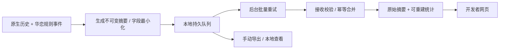

# 塔2 Mod 玩家游玩数据收集、平衡分析与开发者查看方案

> 调研日期：2026-10-23。范围：中英文公开战绩站、开源统计/遥测 Mod、作者文档，以及当前 Karen 客户端与本机两套相关数据服务源码。本文交付调研与建议，未实现或部署新遥测。
>
> 证据分级：**已核实**＝作者文档、公开源码或本地源码可见；**建议**＝结合 Karen 的设计判断；**待验证**＝未接入、未实机或未确认线上部署。公开项目介绍不能替代 Karen 在正式版 v0.107.1 / 测试版 v0.111.0 的兼容测试。

## 1. 建议先做什么

华恋已有“游戏结算上传 → 服务端解析 → 网页查看”基础。最合适的下一步是**延续现有系统，先修数据口径和可靠性，再补华恋机制的战斗摘要，最后把网页升级为开发者平衡工作台**。

建议顺序：

1. 核对上传 JSON 是否完整、是否有 Mod 版本、多人数据属于谁、早期死亡是否被过滤。
2. 保留所有结果；明确区分胜利、死亡、放弃、未完成和采集异常。
3. 第一批看板提供版本对比、选取率与样本量、获得后表现、死亡战斗和单局逐层复盘。
4. 第二批记录闪耀耗尽时机、约定牌堆周转、额外重播与遗物禁用收益。
5. 仅在定位特定问题时启用详细出牌事件，避免一开始记录完整逐帧过程。

外部项目主要作为实现参考和原版背景基线。**目前没有核实任何公共统计站能够完整理解 Karen 的闪耀、约定牌堆及双版本数据，也没有核实可直接导入现有 Karen 数据服务。**

## 2. 全网找到的可参考项目

下表能力来自作者说明或源码；“适合借鉴”是本文建议，均未安装测试。

| 项目 | 已核实能力 | 对华恋的用途与边界 |
| --- | --- | --- |
| [Spire Codex 开发者 API][S2]、[游戏内 Mod][S3] | 自动上传；战绩、选取、战斗统计；API 按版本/人数/模式筛选，提供样本量、Wilson 区间、按获得楼层校正的 lift 等 | 最值得借鉴网页的信息结构和指标展示。其批量导出文档标为 official runs，不能假定包含 Karen 或具备同等完整字段 |
| [Spire Archives][S4] | 外部程序发现并监听历史 .run 文件；去重上传；客户端、后端、前端公开；提供统计与只读 API | 适合参考补传历史、文件扫描及服务端结构。不是逐张出牌记录；作者说明 Steam ID 在服务端做 HMAC，意味着原 ID 会随请求到达服务端 |
| [STS2 Telemetry][S5] | 本地 JSONL、后台上传、检查 CLI；保存 schema/游戏版本/Mod 版本等元数据；公开源码包含身份清理与上传队列 | 适合参考断网补传、分段、状态展示。其[队列源码][S6]有失败退避和容量/时间限制；生产接收与管理后台未公开，不能直接视为完整平台 |
| [Spire Stats & Analytics][S7] | 游戏内按 Q 查看单卡打出、无效抽牌、每能量产出、升级表现、战斗和本地历史 | 适合借鉴“卡牌有没有实际发挥作用”。作者明确间接效果归因仍有限，不能直接当成单卡的因果贡献 |
| [tSC-DataModel][S8]、[集成文档][S9] | 战斗/整局聚合、事件总线、稳定读取接口；采集与显示分层；另有独立上传模块 | 适合评估可选通用战斗统计适配器。README 标明基于 v0.107.1；v0.111.0 和 Karen 自定义机制归因待验证，不宜直接增加硬依赖 |
| [AnalyticsTelemetry][S10] | 本地 NDJSON、战斗钩子、存档上下文、单人/多人查看、可选远程导出 | 适合参考本地故障诊断和低频刷新。作者记录过图表频繁重建造成严重性能问题，提醒采集和 UI 都要控制开销 |
| [Knowledge Demon][S11] | 结算上传、首次导入既有历史、网页个人统计和奖励选牌提示 | 展示了玩家侧自动上传和个人页面的闭环；不能据“兼容其他 Mod”的介绍认定其理解华恋机制 |
| [Save & Load 2 战绩小助手][S12] | 中文逐层战绩报告；作者说明基础读取 .run，Pro 模式配采集 Mod 扩展数据 | 适合参考中文复盘体验及“历史数据 + 扩展记录”的分层方式；没有确认可供华恋直接复用的服务接口 |
| [STS Tracker 更新说明][S13] | 统计按游戏版本拆分；被标记的修改对局保留在个人历史但排除公共汇总 | 借鉴“保存原始记录、通过标签选择分析样本”。华恋本身就是玩法 Mod，不能把所有 modded 对局统称为无效 |

检索也找到中文平衡 Mod 在 README 中引用公共统计站，但这只能证明其把统计站当作参考，不能证明它们部署了独立玩家遥测。未公开的 Discord、群聊和私人后台不在可核实范围内。

## 3. 华恋当前已经有什么

### 3.1 本仓库客户端：已核实

- `src/Core/Patches/RunHistoryUploadPatch.cs` 在 `RunHistoryUtilities.CreateRunHistoryEntry` 后读取 `RunManager.Instance.History`，序列化、注入闪耀耗尽信息并异步 POST。
- `src/Core/Config/KarenModConfig.cs` 中 `EnableDataUpload` 默认 true。
- 角色白名单按 `state.Players.FirstOrDefault()` 判断，包含 ironclad/silent/defect/watcher/karen。没有 regent/necrobinder；多人也没有显式按本地席位判断。
- 上传函数只见一次请求及日志，未见持久队列、自动补传、显式本地上传状态或自定义请求超时。
- `src/Core/Patches/RunHistoryShinePatch.cs` 为每名玩家附加 `karen_shine_exhaust_count` 与 `karen_shine_exhaust_cards`，本地历史也会保存并展示。
- 上述耗尽数据取自结算时 ShinePile 中现存卡牌，**不是逐次耗尽事件日志**，不能据此推出耗尽发生在哪场战斗或哪一回合。
- 上传代码未见主动添加 Karen Mod 版本、平衡规则版本、已加载 Mod 清单或开发测试标记；原版 RunHistory 的 `schema_version` 也不能替代遥测 schema。
- 本次未调用现有生产上传地址，文档不记录客户端内置上传凭据。

### 3.2 本机相关服务：已核实源码，线上状态未知

外部目录统一用占位符表示，避免把本机路径固化进文档。

| 本地项目 | 可见实现 |
| --- | --- |
| `<旧华恋服务仓库>/src/` | Cloudflare Worker + Firestore；已有上传解析和基础统计 |
| `<华恋数据服务仓库>/services/collector/src/server.ts` | 上传接收服务 |
| `<华恋数据服务仓库>/packages/core/src/` | MongoDB 保存、历史解析、选取率、结算携带胜率、曾拥有胜率、CSV 导出 |
| `<华恋数据服务仓库>/services/portal/` | 战绩列表、统计页、单局详情；详情页已有闪耀耗尽列表，另有管理接口 |

现有网页有角色、进阶、单人/多人、游戏版本和楼层等筛选，以及卡牌选取率与胜率展示。**这已经接近可用的基础查看台，优先扩建它。**本次没有确认两套服务哪套正在生产使用，也没有读取生产数据库。

### 3.3 在依赖统计调平衡前，优先核对这些问题

| 优先级 | 已观察事实 | 影响与建议 |
| --- | --- | --- |
| P0 | 客户端使用默认 `JsonSerializer.Serialize(history)`；本地反编译快照中 `CardChoiceHistoryEntry.wasPicked`、`ModelChoiceHistoryEntry.choice/wasPicked` 是公开字段；原生序列化上下文启用了 IncludeFields | 默认序列化会漏字段，上传体不等价于原生 .run。优先核验两版本真实 payload，选用原生序列化或明确 DTO/转换器，不能只加 IncludeFields 就宣称格式完全一致 |
| P0 | 服务端用 `card.floor_added_to_deck` 是否存在推断 `was_picked` | 正确字段存在时优先使用它；旧数据推断需标记来源和置信度，不应把推断混成实录 |
| P0 | 客户端没有明确提交 Mod 版本；服务端虽有 mod_version 字段，现有版本筛选实际使用 build_id | 无法可靠比较同一游戏版本内两次华恋平衡更新；缺失版本必须列为 unknown，不能按上传日期反推 |
| P0 | 服务端按 seed + start_time 去重；多人通过金币/选择等信号猜上传者，聚合主要取该玩家 | 不能保证席位归属正确，也不能保证多份报告合并完整；改为共享对局 ID + 明确本地席位 + 报告者/段 ID |
| P0 | 服务端 `deriveRun` 对 final_floor < 3 直接返回 null | 会丢掉初期死亡，接收端又返回 duplicate，客户端可能仍记录上传成功；应保存全部有效对局，区分已接收/重复/过滤，并把排除条件留在查询层 |
| P1 | 客户端只按第一名玩家白名单决定上传，异常分支默认允许 | 可能漏掉应收数据或扩大范围；按明确同意的本地玩家/角色判定，不以异常作为扩大采集的依据 |
| P1 | TypeScript 把玩家 id 当 number 使用 | 64 位标识超过 JavaScript 安全整数范围可能失真；新 DTO 使用字符串或每局席位别名，并对旧格式单独处理 |
| P1 | cardChoices 的 floor_index 来自每幕数组下标，换幕后从零开始 | 做获得楼层校正前必须保留 act_index + floor_in_act + global_floor |
| P1 | 当前基础单卡统计硬编码排除起始牌 | 起始牌应有独立战斗表现页，不能因此看不到坠落/闪耀打击的体验问题；不参与奖励选取率排序 |
| P1 | 当前缺少持久补传与数据完整性标记；默认上传原生玩家标识等字段 | 断网可能漏报，且默认原始数据范围过大；增加明确告知/开关、最小化 DTO、本地队列、完整性与失败原因 |

序列化问题做了一个**内存中的合成样例验证**：相同结构含 Card 属性和 wasPicked 字段，默认结果仅有 card；IncludeFields=true 后才有 was_picked。微软文档也说明[默认不序列化字段][S16]。这证实了该语言行为；**不等同于已经抓取两版游戏的生产上传包**。

## 4. 玩家信息怎么收集

### 4.1 三层数据，分别解决不同问题

| 层级 | 获取方式 | 能解决什么 | 不能据此判断什么 |
| --- | --- | --- | --- |
| A：整局/逐层历史 | 结算时读取原生 RunHistory，或用户主动导入 .run | 胜负、死因、进阶、奖励选择、商店购买、路线、升级/删牌、最终卡组 | 精确出牌顺序、某牌卡手原因、闪耀逐回合消耗 |
| B：每场战斗摘要 | 战斗开始/结束时记录运行上下文，规则事件累加计数 | 战斗回合、失血、能量、打出/抽到次数、机制周转和收益 | 完整还原任意一次复杂连锁 |
| C：选定对局的详细事件 | 仅在玩家同意的诊断模式或专项测试启用 | 异常连锁、重播归因、恢复/重复统计、疑似无限 | 自动判断最优操作；仅事件也未必足够重放 |

建议默认 A + 精简 B；C 有独立开关、容量上限和保留期。问卷/文字反馈再补“好不好玩、为什么不选、机制是否难懂”，并可附匿名对局编号，不能用统计替代体验反馈。

本地反编译快照中 RunHistory 已有 build_id、ascension、win、was_abandoned、players、map_point_history。逐层 player_stats 中已有 card_choices、cards_gained、cards_removed、upgraded_cards、购买/药水/事件/休息选择、失血和治疗等。**先复用已有记录，缺什么再补钩子。**历史未记录的完整商店货架、决策前卡组/HP 等，不应假定能从最终卡组精确恢复。

### 4.2 建议的最小上传合同

- **标识与版本**：telemetry_schema_version、game_build、game_channel、karen_mod_version、balance_revision、collector_version、platform。
- **对局与席位**：run_id、party_run_id、seat_id、report_id、segment_id、seq；恢复后沿用对局 ID，创建新进程段；同一种子重开仍是新局。
- **上下文**：角色、进阶、模式、人数、队伍角色组合、是否指定种子、开发/修改标记、其他玩法 Mod 的受限标记。
- **结果**：win/death/abandon/incomplete/unknown 分开；时长、到达楼层、死因、采集覆盖范围。
- **奖励选择**：完整选项、选中项/跳过、来源、每幕/全局楼层、升级状态；决策前状态仅在有实际采集时填入。
- **卡牌生命周期**：获得、升级、移除、变化、闪耀永久离开等；区分永久牌组、临时生成牌与 token。
- **战斗摘要**：战斗 ID、敌组、回合、HP 前后与失血/治疗分项、每牌抽到/主动打出/自动重播、实际能量花费，以及下面的机制计数。
- **质量信息**：history_only/summary/detailed、字段缺失、从中途加入、重载分支、未知模型、错误码与丢失段数。

玩家跨局关联如确有分析需要，采用可重置的随机安装别名，并让玩家知道用途；每局内其他玩家优先用席位别名。无需采集昵称、聊天、账号目录、硬件标识或完整存档。已有公共项目的“默认上传”是其产品选择，不代表华恋必须沿用。具体告知、留存与删除方式应在实际落地时确定。

### 4.3 可靠上传与多人处理

- 游戏主线程只读取必要状态、累加计数和排队，不做网络请求、全量序列化或数据库分析；不消耗游戏随机数。
- 关键边界生成不可变快照，再后台编码、压缩、上传。持久化要原子写入；429 遵循 Retry-After，临时错误退避，永久格式错误单独隔离。
- 游戏退出无需等待网络；下次启动补传。界面能看到待上传数、最近成功、失败原因和导出入口。
- 幂等键与内容哈希分开：同一报告重试不重复，合法新增段仍可合并。未知 schema/模型要保留质量标签，不能静默归零。
- 多人拆成“对局表”和“席位表”；一个队伍结果只计一次，多位 Karen 的单卡观察按席位计，但不能当作独立的多个胜负样本。
- 新增明确的本地席位信息，替代第一名玩家或金币消费猜测。只上传获同意范围内的数据；跨玩家详情不随本地默认同意自动扩大。
- 历史补传标明只有 A 层，不能把缺少的 B/C 层补成 0。原有缺版本记录、推断选择记录单独分组。
- 内置客户端上传凭据不能当作管理权限或可信性证明；接收端仍需限额、字段校验及测试/异常标签。

## 5. 怎样用数据进行平衡调整

### 5.1 先固定比较条件和分母

每个图表顶部固定显示：游戏版本/分支、Karen 版本/规则版本、进阶、单人/队伍人数、模式、平台、时间窗，以及完整对局数、独立玩家数、被排除数和原因。

不要把 stable/beta、单人/联机、普通/每日/自定义、开发命令/自然游玩混在一个胜率里。进阶只能部分代表水平；如记录跨局别名，可额外看玩家此前表现和 Karen 游玩经验，避免用本局结果定义本局水平。

| 指标 | 推荐口径 | 可用于什么判断 |
| --- | --- | --- |
| 完成局胜率 | 胜利 /（胜利 + 死亡），同时展示放弃率和以全部终局为分母的胜率 | 角色总体难度、版本趋势；避免只看一种分母 |
| 选取率 | 在可比的自由选择机会中选该牌次数 / 实际提供该牌的机会数；展示分子/分母 | 玩家是否愿意拿；强制获得、变牌、商店和临时生成另算 |
| 获得后胜率 | 曾获得该牌的可用局数中获胜比例，按获得幕/楼层拆分 | 避免只统计最终卡组漏掉被删或耗尽的牌 |
| 结算携带胜率 | 结算仍携带该牌的胜局 / 结算携带该牌局数 | 仅作描述；华恋尤其受闪耀耗尽影响 |
| 条件表现差 | 同版本/进阶/模式/获得楼层等匹配后，选择组与比较组的后续结果差 | 筛查候选问题；仍有玩家选择偏差，不是因果效应 |
| 战斗表现 | 每次进入该敌组的失血分布、死亡率、回合数，附卡组/遗物上下文 | 哪些战斗过难，哪类构筑缺解法 |
| 单卡使用 | 主动打出/抽到次数、可打却未打比例、实际能耗、有效伤害/实际消耗护盾/抽牌等 | 发现卡手、费用问题与低效升级；只对有覆盖的数据算 |
| 构筑多样性 | 各机制/组合占比、随版本的集中程度、对应表现与样本 | 是否只有一条赢法，弱路线是否没有启动工具 |
| 玩家反馈 | 关联对局的体验描述、重复反馈和主动测试结论 | 区分弱、难懂、操作负担高和缺乏乐趣 |

同一奖励界面内重复同名牌应明确按“选项”还是“选择机会”计，推荐以机会为主并保留原始选项；不能把“拿到次数 / 全部对局”标为选取率。每能量产出遇到 0 费牌应另列；自动重播不能与主动打出使用同一分母。回合结束保留牌也不能一律算卡手。

公共站已有版本筛选、样本量、置信区间和获得楼层校正的实例可参考 [S2][S13]。这些方法减轻偏差，并不能证明一张牌造成胜利。

### 5.2 华恋专属指标

| 机制 | 建议先记录 | 对平衡的帮助 |
| --- | --- | --- |
| 闪耀 | 开战/结束闪耀、主动消耗、补充、耗尽事件、耗尽回合、来源牌；最终耗尽牌堆另存快照 | 判断永久成本发生得过早还是过轻；补闪耀是否让高强度牌失去代价 |
| 约定牌堆 | 每场入堆/取回次数、去向、来源、滞留回合/周转、模式；战斗结束未取回数另列 | 判断投入与回收是否匹配，某组件是否不可替代；只存队列长度看不出周转 |
| 全局移牌 | 来源/目标牌堆、触发来源、次数及可确认的衍生收益 | 找零成本循环或触发膨胀；同一动作只记一次语义事件 |
| 额外重播 | 一次主动打出请求、请求/实际重播、来源、能量花费与直接结果 | 避免把同一张牌的多次结算误报为多次主动出牌 |
| 禁用遗物 | 禁用来源、时点、持续战斗/楼层、给予收益、恢复或永久禁用 | 观察代价与收益是否相称；失去的遗物反事实价值只能另做估计 |
| 多人协作 | 对队友的能量/抽牌/有效护盾、减益与重播来源，标记归因能力 | 避免以单纯输出排名误判辅助构筑；不把未经验证的归因说成真实贡献 |

不要把直接伤害、力量增益后的伤害、重播后的伤害同时全部归功于多张牌再相加。优先展示分开的可核实分项；复杂归因标为模型估计。tSC 的采集/契约分层可参考 [S8][S9]，但 Karen 的计数应优先落在本项目已有规则语义入口，例如 `ShineSystem`、`PromisePileSystem`、`GlobalMoveSystem`、`ExtraReplaySystem`、`DisableRelicSystem`，避免仅从动画节点推断规则结果。

### 5.3 从发现到改动的工作流程

1. **先定设计目标**：这张牌应服务什么情景、付出什么代价、是否要容许少数强组合。目标不是所有卡选取率一样。
2. **检查数据质量**：展示机会/选取、缺字段、版本、异常和独立玩家数，排除上传问题造成的假信号。
3. **找候选问题**：持续低选取且获得后表现也弱；高选取、高表现且压缩构筑选择；特定敌组失血明显偏高等。
4. **看局部情景和实例**：按幕、卡组、遗物、玩家经验分组，点开典型胜局与败局。低选取高表现可能是定位狭窄，也可能是高手才会用。
5. **提出机制假设**：例如“约定入堆牌多但取回启动晚”，对应观察周转与首个取回回合，不能直接从低胜率推导加伤害。
6. **做小范围改动**：单次尽量改变一个可解释参数或一个明确交互，给新 balance_revision。
7. **专项测试与玩家试用**：相关双版本验证、种子场景对照、自然游玩与反馈互相补充。相同种子并不保证不同操作后随机过程完全相同。
8. **比较后续同类样本**：新旧版本分组；控制游戏更新和玩家构成。只作相关性判断时明说限制，证据不稳则继续观察或回退。

建议设置“待观察”列表，而不是自动削弱排行。可先把“至少 100 次有效提供且至少 20 个独立玩家”作为人工审查入口，**这是工作流起点，不是统计显著或足够调平衡的保证**。稀有牌、高进阶和联机小样本应更多依赖专项测试。

置信区间必须和样本量一起看：即使观察胜率同为 60%，6/10 的 Wilson 95% 区间约为 31%–83%，60/100 约为 50%–69%，600/1000 约为 57%–63%。同一玩家反复游玩、多人同队和同种子等会相关，不能套独立样本模型后把窄区间当成保证；正式版本差异评估可按玩家/队伍进行聚类重采样，或采用有收缩的分层模型。多卡同时筛查也会产生偶然极值。

Mega Crit 的 GDC 演讲把“每张牌都有位置”、持续迭代、玩家分层与反馈结合起来，强调数据是证据而非结论 [S1]。这个目标比追求单一排行榜更适合角色 Mod。

## 6. 开发者怎么查看最方便

### 6.1 对当前华恋：优先扩展已有 portal

推荐主路径：**打开一个网页 → 选择华恋版本和进阶 → 看异常/变化最大的卡 → 点击具体对局 → 查看逐层/逐战斗证据 → 记录平衡假设**。

| 页面 | 核心内容 | 应能继续点到哪里 |
| --- | --- | --- |
| 总览 | 对局/玩家量、胜死弃、达到各幕比例、同条件版本趋势、数据新鲜度/覆盖率 | 该样本组的战绩列表 |
| 卡牌 | 选取/提供、获得后表现、结算携带、升级/移除、获得楼层、样本区间 | 单牌详情、涉及该牌的胜败对局 |
| 战斗与死因 | 敌组进入数、死亡率、失血 P50/P90、回合分布；按幕和路线区分 | 该敌组的典型战斗 |
| 华恋机制 | 耗尽回合、约定周转、重播倍率与实际成本、禁用遗物收益/时长 | 对应机制事件或战斗摘要 |
| 版本对照 | 同一游戏版本内两次 Karen 规则版本；展示玩家构成和样本差异 | 新旧样本及改动说明 |
| 数据质量 | 队列失败、重复报告、缺字段、旧格式、开发局、未知版本、未完成 | 可受控查看的原始记录/导出 |

实用细节：

- 中文名 + 卡图悬停 + 稳定模型 ID；按版本读取卡牌定义，不能把新卡面说明套到旧数据。
- 所有表都显示分子/分母；无覆盖显示“未采集”，不显示 0；小样本降低视觉强调。
- 筛选条件写入 URL，便于保存和分享同一个比较范围。
- 单卡页保留“首次获得楼层”“最终是否耗尽/移除”的拆分，避免闪耀牌被携带胜率误导。
- 对局详情采用逐层路线和战斗摘要时间线；这叫复盘，不宣称可重播。
- 详细 JSON 放在开发者入口；公开页仅暴露必要摘要，稳定玩家别名与未清理历史不应默认公开。
- CSV/JSON 导出携带筛选、指标版本和数据更新时间，以便复核。
- 初期沿用 TypeScript + MongoDB + 现有网页即可。可增加可重建聚合表/集合和索引，避免每次页面请求扫描全部历史。

### 6.2 什么时候用现成 BI 工具

| 选择 | 适合情景 | 对本项目建议 |
| --- | --- | --- |
| 现有 portal | 要中文卡图、机制标签、单局地图、版本关联 | **主方案**，最大程度复用已有代码 |
| Metabase | 开发者想快速筛选、透视、拉图表，并从汇总查样本 | 可作为内部分析补充；官方支持 [MongoDB 连接][S14] 和[图表点击跳转][S15]。先建立扁平摘要/选择/战斗集合，具体查询和权限需验证 |
| Streamlit / Python | 临时分析导出的数据、尝试统计模型和新指标 | 用作离线探索；其[交互表格][S17]可满足基本查看，但长期再建一套会增加维护 |
| 独立公共战绩站 | 看原版背景、参考交互和统计方法 | 不替代华恋自有数据，也不保证双方样本与口径可比 |

Metabase 的公开嵌入不等于完整的开发者交互权限，原生查询和图形查询的下钻能力也有区别；首期可直接作为独立内部站使用，不必承诺完整嵌入现有网页。本文未安装、部署或评估任何付费方案。

## 7. 分阶段落地清单

| 阶段 | 交付 | 验收重点 |
| --- | --- | --- |
| P0：确认数据能信 | 原生/上传 JSON 对照、显式游戏+Mod+规则版本、明确席位、保留早死/放弃、失败队列 | 断网后补传不丢不重；各终局计数可解释；已知选择不被丢失；新旧格式可区分 |
| P1：已有网页升级 | 版本对比、样本量/区间、获得楼层、敌组死亡与失血、单牌→对局链接 | 从异常统计能找到具体记录；相同筛选返回一致结果；无数据不等于 0 |
| P2：华恋战斗摘要 | 闪耀、约定、重播、移牌、禁用遗物的可解释计数与时间点 | 一次规则事件只记一次；自动重播不冒充主动打出；读档不重复累计；采集不改变游戏随机或规则 |
| P3：深入归因/模型 | 可选详细事件、聚类/条件模型、针对性平衡实验 | 明确估计与实录边界，显示不确定性；收益超过维护与性能成本再保留 |

后续真要实现时，按实际改动做定向验证：正式版/测试版的 payload、单人/多人席位与去重、恢复/放弃/死亡/胜利、断网补传、字段缺失和采集开销。若涉及移牌，按项目规范保存并查看 MCP 前后截图、动画结束执行 karen_check_hand。本次仅改文档，没有游戏功能变更；未运行完整矩阵或发布检查，也不据此宣称运行兼容。

## 8. 来源与证据说明

下面均为作者项目、作者网站或官方文档，检索日期为 2026-10-23。项目描述代表公开源码/文档状态；未确认线上可用性、维护承诺、所有许可证或 Karen 适配。若要复制代码，另核对应版本许可证；本次未复制外部实现代码。

- [S1：Mega Crit / GDC 2019，Metrics Driven Design and Balance 讲义][S1]：设计目标、玩家分层、反馈与迭代。
- [S2：Spire Codex 开发者 API][S2]：统计字段、版本/模式分组、置信区间、批量导出边界。
- [S3：Spire Codex Mod][S3]：自动上传与游戏内展示。
- [S4：Spire Archives README][S4]：.run 监听、去重、接口与身份处理。
- [S5：STS2 Telemetry README][S5]、[S6：上传队列源码][S6]：本地记录、元数据、队列与公开范围。
- [S7：Spire Stats & Analytics README][S7]：逐牌/战斗分析及归因限制。
- [S8：tSC-DataModel README][S8]、[S9：集成指南][S9]：接口分层、事件与版本范围。
- [S10：AnalyticsTelemetry README][S10]：本地统计、导出与图表性能经验。
- [S11：Knowledge Demon Mod][S11]：自动上传、历史导入与个人页。
- [S12：Save & Load 2 作者文档][S12]：中文复盘与扩展采集。
- [S13：STS Tracker 更新说明][S13]：按版本划分及异常样本处理。
- [S14：Metabase MongoDB 文档][S14]、[S15：仪表板交互][S15]：连接与查询交互。
- [S16：Microsoft System.Text.Json 字段序列化][S16]：默认不包含字段。
- [S17：Streamlit dataframe 文档][S17]：临时交互分析能力。

本地证据：

- 本仓库基线：d217fcc75ab50b9c822ca3fb2ba7d39668f5bf74；客户端与配置见第 3 节路径。
- `<游戏反编译参考>/src/Core/Runs/{RunHistory,RunHistoryPlayer,RunHistoryUtilities,PlayerMapPointHistoryEntry}.cs`。
- `<游戏反编译参考>/src/Core/Runs/History/{CardChoiceHistoryEntry,ModelChoiceHistoryEntry,MapPointHistoryEntry}.cs`。
- `<游戏反编译参考>/src/Core/Saves/{MegaCritSerializerContext,Managers/RunHistorySaveManager}.cs`。
- `<华恋数据服务仓库>/packages/core/src/{run-transform,repository,stats}.ts` 及两个服务、网页源文件。
- `<旧华恋服务仓库>/src/{stats,repository,run-transform}.ts`。

这些外部本地目录不是本次任务工作树的一部分，仅作只读调研；其未提交状态、部署版本和生产数据量未审计。

[S1]: https://media.gdcvault.com/gdc2019/presentations/Giovannetti_Anthony_SlayTheSpire.pdf
[S2]: https://spire-codex.com/developers
[S3]: https://spire-codex.com/mod
[S4]: https://github.com/JoeyRussoniello/Spire-Archives/blob/main/README.md
[S5]: https://github.com/nodca/sts2-telemetry/blob/main/README.md
[S6]: https://github.com/nodca/sts2-telemetry/blob/main/src/Sts2Telemetry/TelemetryUploadQueue.cs
[S7]: https://github.com/JonahJ5/SpireStats/blob/main/README.md
[S8]: https://github.com/latentspacez/tSC-DataModel/blob/main/README.md
[S9]: https://github.com/latentspacez/tSC-DataModel/blob/main/docs/integration.md
[S10]: https://github.com/drwahl/AnalyticsTelemetry-StS2/blob/main/README.md
[S11]: https://knowledgedemon.com/mod
[S12]: https://www.iryougi.com/index.php/docs/sl2/
[S13]: https://ststracker.app/news
[S14]: https://www.metabase.com/docs/latest/databases/connections/mongodb
[S15]: https://www.metabase.com/docs/latest/dashboards/interactive
[S16]: https://learn.microsoft.com/en-us/dotnet/standard/serialization/system-text-json/fields
[S17]: https://docs.streamlit.io/develop/api-reference/data/st.dataframe
