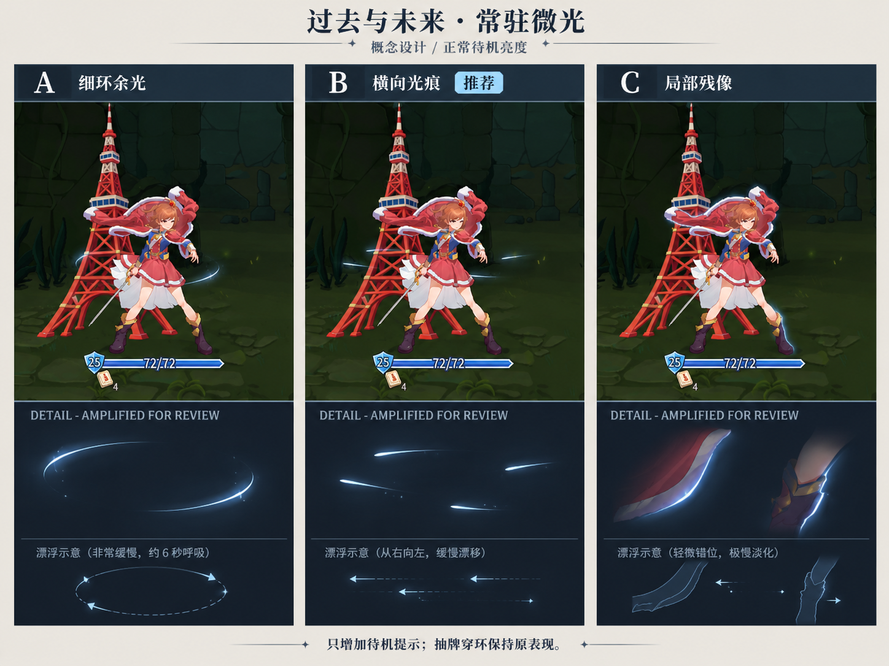
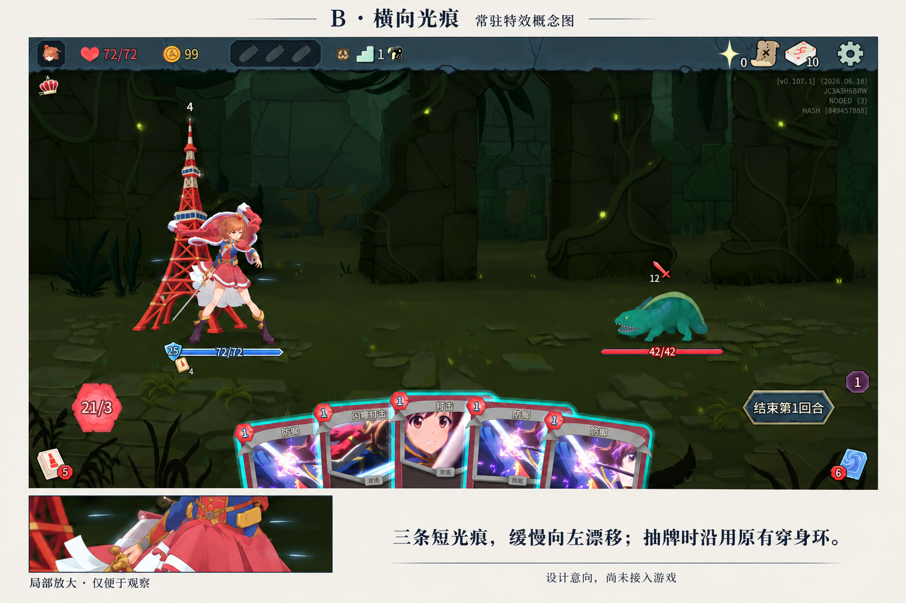
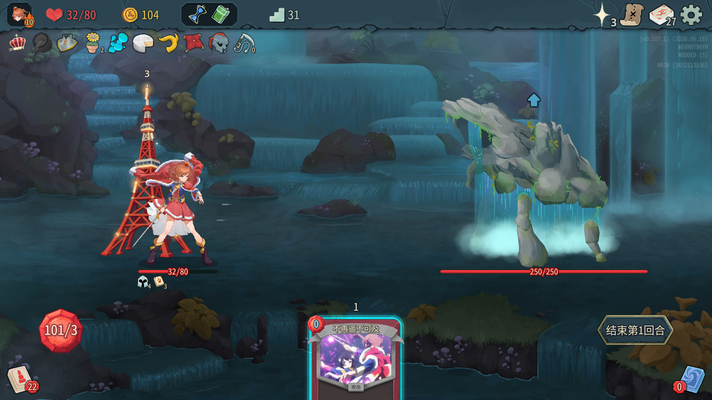

# 《过去与未来》低存在感常驻特效概念设计

## Original user input

> $worktree-task 感觉过去与未来需要一个不太显眼的常驻特效，你来用imagegen设计设计

用户显式指定 `$worktree-task`，并要求使用 imagegen。初始阶段交付概念设计。

后续原文：

> 选B，你来实现吧

按用户选择继续实现 B「横向光痕」，复用原 worktree，完成前不合并回原分支。

再次反馈原文：

> 看不到效果

继续在本 worktree 调整原尺寸下的可见度；该反馈不是合并授权。

最新反馈原文：

> 看起来和参考图不一样，而且没有啥动态效果

继续修订形态和运动；不视为对亮度、方案或合并的认可。

## Brief task plan

1. 从原分支已提交版本建立独立 worktree，记录并保留原 checkout 的未提交文件。
2. 阅读卡牌、现有穿环特效和历史设计，观察卡图与实际战斗参照。
3. 用内置 imagegen 制作三种低亮度常驻方案，再细化推荐方案的完整战斗构图。
4. 保存概念图、完整提示词及设计说明，检查图像和文档后合为一个任务提交；同步原分支，等待明确合并确认。

## Result and changes

已完成两张概念图和两份完整提示词，用户选择 B「横向光痕」后已完成代码实现与双版本专项验证。最终结果见文末「B 方案实现跟进」。

### 设计依据与范围

- 卡牌定义：`src/Core/Models/Cards/promisePile/KarenPastAndFuture.cs`。当前构造器为 1 费能力牌，从约定牌堆取牌时获得临时力量，升级获得固有；历史注释不能替代当前代码。
- 触发接线：`src/Core/Models/Powers/KarenPromisePilePower.cs` 中模式启停控制 VFX，在取出约定牌时调用 Pulse。
- 现有效果：`src/ShoujoKagekiAijoKaren/GodotScripts/PromisePileSystem/Vfx/NKarenPastAndFutureRingVfx.cs` 仅绘制活动中的穿身环；没有待机装饰。右向左的触发方向、前后遮挡和有界连续环流是本次设计保留的视觉语汇。
- 卡图参照：`images/packed/card_portraits/karen/karen_past_and_future.png` 中可见蓝白圆形光源，取其冷白浅蓝配色。本设计不声称新光痕是原作中已验证的镜头或装置。
- 历史约束：已阅读 `docs/design/rare-vfx/past-and-future-source-selection.md` 和 `docs/testing/past-and-future-vfx-2026-09-28.md`。旧双门与蓝金分色不是本次设计依据。用户本次明确提出常驻需求，因此补充低强度待机提示。
- 场景参照：`docs/design/promise-tower-painted-2026-10-09/game-v3-stable.png`；人物参照：`images/packed/Karen.png`。这是既有画面参考，非本次新录制的游戏截图。

### 三案比较

| 方案 | 形态 | 取舍 |
| --- | --- | --- |
| A 细环余光 | 人物后方少量不闭合的淡蓝圆弧 | 最直接呼应卡图圆形光源，但容易被读成护盾；不是首选。 |
| B 横向光痕（推荐） | 腰侧约三条极短的冷白浅蓝光痕，向左缓漂 | 呼应已有穿环的方向，空白多，叠加其他能力时容易压低存在感。 |
| C 局部残像 | 披风和腿部后缘少量错位轮廓 | 最安静，但容易被误解为人物发光或残影状态，且更依赖轮廓适配。 |

第一张概念图的局部展示明确放大了效果以便比较，不作为最终亮度标尺；因此继续制作了较暗的完整战斗细化图。

### 推荐细化：横向光痕

- 常态只出现约三条短光痕，限制在腰侧与大腿上段周围，主体在人物后层。
- 冷白／浅蓝，避免与场景绿萤火、红色燃烧效果混同。
- 以原始 1280×720 参考画面为量级：核心线宽约 1 px，核心长度约 5–10 px，淡尾约 12–16 px。真正实现时仍须按角色缩放和画面分辨率适配。
- 峰值透明度建议 0.08–0.12，缓慢左右错时淡入淡出，从右向左漂移；数值只是未来实现起点，并非图像生成模型精确遵循或实机验收的结果。
- 保留大量空白，不连成整条光带，不遮脸、躯干、血条或约定塔库存。
- 抽牌时继续播放现有穿身环；可在穿环期间把常驻光痕再压暗，避免两套反馈叠亮。此处仅是后续实现建议。
- 本次没有增加声音。未来实现默认保持常驻无声，且应沿用 owner、模式结束与退树清理边界。
- 图像为生成式概念合成，可能重绘局部场景或 UI，不能当作逐像素保持原截图、真实运行效果或新功能测试证据。

### 生成方式与完整提示词

使用内置 imagegen，未使用 CLI/API fallback。输出保存在本任务目录内，不依赖生成服务的默认保存目录。

- 三案对比：`prompt-comparison.txt` → `concepts/comparison-v1.png`。
- B 方案细化：`prompt-refined-b.txt` → `concepts/horizontal-traces-v2.png`。
- 第一轮输入依次为场景截图、卡图、人物素材；第二轮输入为同一场景截图和第一轮对比图。完整提示词明确区分编辑目标和风格参考。
- 两张 PNG 都是设计稿，不是运行时精灵或透明贴图。未自动把它们接入资源目录或游戏。

### 验证

- 已查看两张生成图：三种形态可以区分；B 的完整场景示意保持人物、塔、敌人与手牌的主要视觉层级；亮度比三案对比稿更克制。
- 已检查 PNG 文件头、尺寸、文件大小，以及生成源与 worktree 副本的 SHA-256 一致性。
- 已检查 UTF-8 文档、JSON 快照可读、文档没有本机绝对路径、Git 补丁无空白错误。
- 以上为概念设计阶段的验证；后续实现另有编译与实机专项记录，不能用生成式概念图代替运行验证。

### 工作树与集成状态

- 原分支：`main`。
- 起始提交：`7c78e66e2db2d142f231ddf1b57c92fece4fb334`。
- 任务分支：`codex/past-and-future-ambient-design-20261022`。
- worktree：`../worktrees/STS2_ShoujoKagekiAijoKaren/past-and-future-ambient-design-20261022`。
- 原 checkout 的 13 个未提交／未跟踪文件未带入 worktree；相对路径和内容指纹见 `original-checkout-state.json`，用于集成前复核。
- 设计稿、实现、专项工具和证据合为一个任务提交；同步本地原分支后，原分支合并和 worktree 清理分别等待用户明确确认，当前均未执行。

## B 方案实现跟进

### 计划

1. 在现有穿环节点后层增加固定三条低亮度光痕，不添加独立管理器或改变抽牌规则。
2. 使用现有角色尺寸、绝对缩放、owner、淡出与退树清理；抽牌穿环期间压低常驻亮度。
3. 双版本编译，在 worktree 内独立游戏副本做待机、真实约定抽牌、缩放翻转、叠加、停止/重启和换房专项；保存 MCP 截图、手牌核对与录像。
4. 汇总实际验证结果，合并本任务设计和实现为一个任务提交，同步 main；合并和清理继续分别等待明确确认。

### 结果

已完成实现和针对性验证，尚未合并回 main 或更新共享开发游戏中的 Mod。

- 运行时只改 `src/ShoujoKagekiAijoKaren/GodotScripts/PromisePileSystem/Vfx/NKarenPastAndFutureRingVfx.cs`。固定三条冷白浅蓝短光痕在角色后层的腰侧短轨道漂移，7.5 秒错时循环，初版核心透明度约 0.12；根据“看不到效果”的反馈，当前提高到 0.32，核心局部线宽由 1.35 提高到 2.2、长度由 8–12 提高到 16–20，使原生 1280×720 中约有 1 px 线宽、8–10 px 核心长度。渐隐结束后无跳变闪现。
- 使用现有角色绝对缩放与 VFX 锚点，翻转不改变从右向左的方向；不增设独立节点、纹理或音源。
- 穿环出现时常驻强度缓降到 0.3，结束后恢复；环境叠加继续读取 `KarenVfxComposition.AmbientWeight`。三条光痕不注册新的全场压暗来源。
- 原八环参数、连续流上限、约定抽牌、临时力量与卡牌规则未修改。停止、淡出中重启、换房清理沿用原节点生命周期。
- 测试工具增加 `PastAmbientCmd`（仅隔离测试插件），并为 `PastStreamProbe` 补充逐帧最低常驻强度观察。可复现脚本为 `tools/vfx/past-and-future/verify.py`，说明见同目录 README；测试插件不进入发布包。

### 实机与编译结果

| 检查 | 正式版 v0.107.1 | 测试版 v0.111.0 |
| --- | --- | --- |
| 完整包编译 | 通过，运行时 DLL 0 错误／28 警告 | 通过，运行时 DLL 0 错误／28 警告 |
| 待机漂移与后层归属 | 通过 | 通过 |
| 正常／0.5 倍／0.5 倍翻转／1.5 倍／恢复 | 通过，缩放误差 0 | 通过，缩放误差 0 |
| 真正打出约定抽牌攻击 | 取出 2 张，临时力量增加 2 | 取出 2 张，临时力量增加 2 |
| 抽牌时降亮及结束恢复 | 观察到 0.3 → 1 | 逐帧最低 0.3，结束恢复 1 |
| 燃烧叠加 | 通过，常驻权重 0.86 | 通过，常驻权重 0.86 |
| 停止／淡出中重启／再停止 | 通过，仅一个归属节点与前层 | 通过，仅一个归属节点与前层 |
| 换战斗清理 | 原节点与前层均为 0 | 原节点与前层均为 0 |
| 操作前后 MCP 截图与 `karen_check_hand` | 通过，无缺失／额外节点或牌堆图标 | 通过，无缺失／额外节点或牌堆图标 |
| 本次日志 ERROR／Exception | 未检出 | 未检出 |

每版保存 15 个状态观察检查，以及实际移牌前后手牌身份核对。最大锚点误差约 0.000087，缩放误差为 0；实际加载 DLL 与本次构建包 SHA-256 一致。当前两版均使用逐帧最低值观察降亮，排除接口响应时序差异。

首轮测试定位了渐隐插值过暗与测试夹具遗漏攻击目标的问题；第二轮目视发现横穿身体的轨迹会被主体遮住，最终收敛为腰部两侧短轨道。这些失败记录保留在忽略的旧 artifacts 目录，首次实现阶段使用 `artifacts/past-ambient-test-v3/`；可见度反馈后的当前复核目录见文末。

### 视觉证据与录像

- 初版原始 MCP 待机截图保留为 `evidence/stable-idle.png`、`evidence/beta-idle.png`；可见度修订后的同相位原始帧为 `evidence/stable-idle-visible.png`、`evidence/beta-idle-visible.png`，正式版关闭对照为 `evidence/stable-idle-hidden.png`。
- [验证摘要](evidence/verification.json) 保留逐项状态、加载 DLL 哈希、真实抽牌增益、手牌核对与录像统计。
- 首次实现阶段的原片、操作 JSONL、MCP 前后图、完整日志位于 `artifacts/past-ambient-test-v3/<版本>/`；两个独立用户目录、游戏副本和端口位于该输出根目录的 `isolated/` 下。
- 初版每版 `review.mp4` 直接拼接 `idle.mp4` 和 `draw.mp4`，12.1 秒，原生 1280×720、H.264、30 fps、无声，不补画特效、不改色或时间轴。
- 已查看实际录像的连续帧与抽牌帧：细光痕缓慢左移，原穿身环仍出现；角色、血条及手牌保持可读。放大审阅图只做像素放大，没有提高亮度。
- 初版正式版实际采帧约 29.9 fps，两片段各补帧 1、丢帧 0；测试版约 29.1–29.6 fps，两片段各补帧 4、丢帧 0。当前修订的采帧统计见最新验证摘要。

### 范围与集成

本次只运行与改动直接相关的双版本单人专项，未跑完整矩阵或多人实测；不把编译或单人结果写成多人验收。原分支的 13 个未提交／未跟踪文件保持原样，集成前按原快照逐一复核。没有部署到共享正式版、测试版或 Steam 目录；任务 worktree 和构建产物保留，等待明确合并确认。

## 可见度反馈跟进

已完成低可见度修订。此前的原尺寸实录过于微弱，用户反馈属实；旧版只有极少数亮点能在原尺寸保留下来。

### 复现、原因与修复

- 使用 `$diagnosing-bugs` 的对照方法：在隔离测试插件中短暂暂停场景和时间，固定效果相位，保存真实 viewport 的开启与关闭 PNG，然后恢复原状态。没有对截图做增亮或改色。
- 原尺寸可见度检查：`python tools/vfx/past-and-future/visibility_audit.py artifacts/past-ambient-visibility-baseline/stable`。旧版已实际运行并失败：`peakChannelDelta=40, pixelsDeltaAtLeast30=2, backgroundPixelsDeltaAtLeast10=0, passed=false`。
- 主要原因是局部坐标中的 0.12 发光强度与细线，经过角色及画布缩放、抗锯齿后只剩少量高差异像素；角色／塔的遮挡进一步减少可见片段。录像压缩不是唯一原因，原始 PNG 中也能复现。
- 先只把强度改为 0.32 验证，达到 28 个高差异像素；随后补足原尺寸线宽和长度，最终两版均达到 54 个高差异像素，峰值通道差 102，背景差异为 0。
- 数量、颜色、7.5 秒漂移周期、后层归属、抽牌降亮至 0.3 与原穿身环均保留。修改仅提高常态短光痕的可读性。

### 当前复核与证据

- 正式版：`artifacts/past-ambient-visible-final/stable/`；测试版：`artifacts/past-ambient-visible-confirmation/beta/`。两版各 15 个状态观察、真实取牌、手牌身份、叠加、缩放翻转、停止重启与换房检查通过；实际加载 DLL 哈希见最新 `evidence/verification.json`。
- 当前两版同帧可见度检查均通过：峰值通道差 102、通道差至少 30 的像素 54、背景差异像素 0。这个检查用于防止近乎不可见的渲染退化，视觉判断同时使用原尺寸截图与实录。
- 初次测试版复核遇到一条 Common 预加载前的原生 `WorkerThreadPool Invalid Task ID`，栈与项目既有记录一致；保留失败日志，审计按版本、准确错误文本、原生栈和 Common 完成边界单列此诊断，任何战斗期错误继续使测试失败。最终复核的启动诊断与运行错误均为空，不宣称修复了引擎问题。
- 新版正常大小待机停留延长为 7.5 秒，之后展示变形和原穿环。正式版 `review.mp4` 为 16.57 秒、原生 1280×720、30 fps、无声，直接拼接实际片段。主开发环境及 Steam 安装均未更新。
- 已解码并目视实际 MP4 的画面确认短光痕经过视频编码后仍可辨认；`idle-closeup.mp4` 为正常大小阶段的 7.5 秒局部裁切放大，仅改变构图，未调亮度或时间。
- 当前原始帧和关闭对照已保留在本任务 evidence；`stable-closeup-visible.png` 仅作局部像素放大，未改色、增亮或补画。

预防同类问题：原尺寸可见度开关对照已加入专项流程，节点生命周期检查与原生像素对照同时保留。未增加生产调试接口或进行架构改造。本次仍未运行完整矩阵或多人实测，worktree 保留并等待用户评审；“看不到效果”的反馈没有被视为合并授权。

## 原分支推进后的同步复核

用户评审期间，本地 main 已推进到 `b5b94a8d43551dc5c5d643f9b0e962edc6a4b227`，新增小白遗物前两回合逻辑、遗物文本和专项工具等改动。已将该 main 同步到任务分支，没有覆盖或重写原分支。

- 与完整专项通过时的功能提交 `a6e6c74` 对比，本次光痕节点、其 Manager 和约定能力 Hook 文件完全相同；遗物改动发生在回合结束路径，本次专项没有触发该新逻辑。
- 同步后重新构建完整双版本包，0 错误；再次在各自隔离副本中真实开战、打出能力，复核 owner、待机动画和同相位开启／关闭渲染。
- 正式版原尺寸可见度检查：峰值差 102，高差异像素 54；测试版：峰值差 102，高差异像素 52；两版背景差异均为 0，均通过阈值。
- 记录与实际加载 DLL 哈希保留于 `evidence/synchronized-verification.json`；当前完整原始证据位于 `artifacts/past-ambient-synchronized/`。完整的真实取牌、缩放、叠加和清理专项是在同步前完成，两版各 15 项通过，没有把本次补测写成完整矩阵复跑。
- 同步复核的运行期错误为 0；启动期诊断按严格规则单列。再次核对原 checkout 的 13 个未提交／未跟踪文件，路径和内容指纹保持一致。尚未合并回 main，也未更新共享开发环境；worktree 与实录继续保留。

## 参考形态与动态反馈跟进

### 修订计划

1. 对照 B 概念图的尖头、浅蓝柔尾与错落分布，替换平头 DrawLine 光痕；使用三个后层 procedural shader 小面片，不引入新音效。
2. 先记录原尺寸实录的运动负例，再缩短并错开周期，提高半秒内可察觉的漂移，保留少量上下浮动和轻微倾角。
3. 用同一原尺寸视频分析脚本核对位移，再目视真实连续帧和参考形态；像素检查不替代审美验收。
4. 双版本只跑相关单人专项，核对原穿环、真实取牌、淡出、缩放翻转、叠加及三片的创建与释放。

已建立负例：`motion_audit.py` 读取此前正式版原生录像的前六个半秒采样，匹配 8 对蓝白光痕，速度中位数 3 px/s，未达到 8 px/s 的最低可读运动阈值，实际失败。自动检查只锁定运动过慢问题；形态是否符合概念仍须实际画面审阅。

### 同步前已验证的修订

- 移除常驻的 DrawLine 分段矩形，改用 `materials/vfx/past_future_trace.gdshader` 的解析尖芯、弯曲蓝尾与柔光。只创建三个 ColorRect 子面片，共享一个材质；使用父节点的淡出，随 owner 一起释放，不添加每帧纹理或音源。
- 三条分别采用 3 / 3.6 / 4.5 秒寿命，错时出入；右向左行程 96–108 局部单位，并有 ±5 单位浮动与轻微摆角。时钟以 18 秒公倍数折返，保持相位连续。左侧轨道单独外移，减少约定塔遮挡。
- 双版本完整包重新构建通过，运行时 DLL 0 错误、28 警告；正式版最终实现 15 项单人专项通过，实际取出两张约定牌并增加两点临时力量。三子面片数量、淡出重启、缩放翻转、叠加、换房清理、手牌身份通过，日志没有运行错误。
- 正式版原生 MP4 的六个半秒采样匹配 6 对，左移速度中位数 15.57 px/s；此前旧实录是 3 px/s。固定相位原始开关图峰值差 173、高差异像素 89、区域外差异 0。结果保留在 `evidence/stable-motion-audit.json`、`evidence/stable-visibility-audit.json`，旧运动负例为 `evidence/motion-baseline.json`。
- 已目视原尺寸帧、六帧连续局部图与真正移牌前后 MCP 截图：细尖／渐消尾区别于旧平头短线，左右错落、位置连续变化；外移后左侧第三条可见。尚未把这些观察写成用户认可。
- 正式版原始完整证据位于 `artifacts/past-ambient-motion-final/stable/`；同步最新 main 和测试版实机复核待做。
- 同期 main 已推进至 `5c7aa359d1f9a1fa9b432c7b43e2a6f265d8c548`（双星卡牌及特效），其提交更新了特效总览文档，因此原 checkout 中该文档整体指纹与初始快照不同；其余 12 个文件指纹仍一致。本任务没有写入原 checkout，新一轮只读快照为 `pre-motion-sync-original-state.json`。
